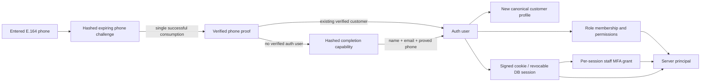

# Authentication foundation — Task 05A

Implemented 2026-11-11 against the installed Better Auth/Drizzle adapter **1.7.19**, Drizzle ORM **0.45.4**, `pg` **8.23.1**, Zod **4.6.7**, Next.js **16.2.1** and Node **24.11.1**. Installed library source, the existing [identity contract](identity-customer-schema.md) and Next.js authentication/route-handler guides informed this implementation. See [the handoff](handoffs/task-05a.md) for verification evidence and limitations.

This document describes the 05A foundation. Task 05B now replaces CMS login/cookies and guards existing admin handlers/pages; see [auth-integration.md](auth-integration.md). Authentication still defaults to unavailable and no real phone sender is configured. Customer account data stays closed until Task 10 ownership work; real activation is not authorized by either slice.

## Ownership and structure

| Owning file | Responsibility |
|---|---|
| `src/server/auth/schema-options.ts`, `src/server/db/auth-tables.ts` | Existing pinned library field/table mapping; unchanged |
| `config.ts`, `validation.ts` | Explicit private environment configuration, bounded strict request shapes and normalized contacts |
| `factory.ts` | Library session/cookie/password/TOTP machinery and restricted custom customer phone flow |
| `phone-service.ts` | Delivery interface, hashed phone challenges, shared application budgets and completion transactions |
| `http.ts` | Public endpoint allowlist, origin/body checks, safe responses, network budgets and serialized MFA admission |
| `principal.ts` | Signed-session resolution, active-user checks, current permissions, per-session MFA and revocation |
| `bootstrap.ts`, `scripts/auth/bootstrap.mjs` | Explicit first-operator credential creation and conservative role defaults |
| `runtime.ts`, `src/app/api/auth/[...all]/route.ts` | Lazy disabled-by-default Node runtime; no build-time DB connection |
| `src/server/db/schema/auth-runtime.ts`, `drizzle/0005_auth-runtime.sql` | Three additive runtime tables and SQL guards |

All entries are server-only. Plain Node commands use `--conditions=react-server`; browser code must never import the auth factory, driver or configuration. Domain handlers should call `requirePrincipal` or `requirePermission` and then enforce record ownership inside the operation. Those helpers do not secure a handler until it actually calls them; sensitive mutations also need transaction-level authorization/concurrency appropriate to their domain.

## Data relationships

Entered contact text remains separate from identity. Quick checkout will create a provisional profile with name, phone and delivery address, without requiring email or creating a library user. Full profile completion requires name, email and verified phone because the pinned library requires user email. An existing verified customer can subsequently sign in with phone proof; email delivery/verification is not used for this flow.

Completion creates a **new** canonical profile. It does not merge older provisional profiles, claim historical orders, transfer addresses, or match an account by entered email. Existing-contact conflicts produce a safe 409 and require sign-in or a future recovery process. Concurrent completions are constrained by the unique canonical user phone/email and profile ownership, inside an atomic proof-consumption/user/profile/audit transaction. Historical order/profile claim policy remains Task 10.

## Runtime schema and invariants

Migration 0005 follows completed 0000–0004 without rewriting them. It adds three tables, bringing the modeled schema to **97 tables**; all 94 prior table definitions are unchanged.

| Table | Data and lifetime | Guard |
|---|---|---|
| `phone_challenges` | UUID, E.164 phone, HMAC-SHA256 code digest, failure count, creation/expiry/consumption | Identity/digest/expiry immutable; failures cannot decrease; consumed rows cannot change |
| `staff_session_grants` | Session PK/FK, user FK, `totp` or `backup_code`, verification time | Must match a live session, active staff user and verified MFA factor; ownership frozen, verification time cannot move backwards |
| `auth_request_budgets` | HMAC-derived unique key, positive count, finite expiry | Atomic conditional upsert admits only the configured number of requests per window |

The challenge and admission triggers are custom SQL, absent from Drizzle snapshots. Preserve them in later migrations. Library counters stay in existing `auth_rate_limits`; application counters use their own table because library cleanup can delete rows older than its shorter window. Raw phone/email/IP values do not appear in budget keys.

The application must expire/delete old challenges, completion capabilities and budget rows through a bounded future maintenance job, observing the security retention policy. No cleanup worker is launched here. Retained counters do not regain capacity inside their window; expiry alone does not permit proof replay. Challenge tables contain personal data and must remain private.

## Customer phone flow

1. `POST /api/auth/grmn/phone/send` accepts only `{phoneNumber}`. It requires an injected real sender. A transaction serializes a phone's challenge replacement, consumes earlier pending challenges and stores only HMAC(secret, challenge ID + phone + code). The six-digit code has a five-minute maximum lifetime. External delivery occurs after commit; failure invalidates the challenge and returns 503. No code/token is logged or returned by HTTP.
2. `POST /api/auth/grmn/phone/verify` accepts `{phoneNumber, challengeId, code}`. One atomic update consumes the correct code or increments a failed attempt. Five wrong guesses exhaust the challenge, including concurrent guesses; replay, expiry and another phone fail. In-memory opaque proof objects cannot be forged by passing an object with matching fields.
3. For an active existing verified non-staff customer, the library creates a signed session. Staff and MFA-enabled accounts cannot use this shortcut. For an unknown phone, proof creates a ten-minute random completion capability: only its SHA-256 digest is stored. The browser receives a signed HttpOnly cookie scoped to the completion path and a `complete_profile` state, without a full session.
4. `POST /api/auth/grmn/phone/complete` accepts only name, email and phone. It consumes the signed-cookie capability for that exact phone and atomically writes the canonical user/profile and audit. Email remains unverified. The library then creates the customer session. If session issuance fails after commit, a later verified phone sign-in recovers access; completion is not repeated or used to claim existing records.

Library raw phone send/verify/reset, public signup and general user-update endpoints are excluded from HTTP dispatch. The phone plugin supplies the pinned schema machinery only; its default stored-OTP flow is not exposed.

## Staff authentication and authorization

Staff sign in through `POST /sign-in/email` with their explicitly created password, then verify TOTP or a backup code. Unknown and wrong credentials share the same public failure body; the library performs password work for missing users. Customer accounts cannot gain staff password sessions through this path. Public signup and accepting source/default plaintext credentials are disabled.

Password-only sessions never pass a staff principal check. Enrollment uses `/two-factor/enable`, returning an authenticated enrollment URI and backup codes for immediate secure storage. First enrollment must be verified. Existing MFA cannot be re-enrolled through a stale password-only session. Backup codes are encrypted at rest; successful backup-code verification consumes the code. General factor disable/reset/recovery endpoints remain unavailable pending a deliberate recovery policy.

Successful TOTP/backup verification creates a grant for the **specific browser session** and writes `staff.mfa_verified` in the same transaction. The handler resolves the signed response cookie because enrollment can rotate a session while the pinned library returns an older JSON token. A grant/audit failure cannot commit admission. Other password-only sessions remain unadmitted even after the user enrolls MFA.

Library factor verification and application admission are separate commits. If admission fails afterward, a backup code may already be consumed or a session rotated, but no new admission grant is committed. After the dependency is healthy, sign in again and use TOTP or another retained backup code; do not repeat the consumed code or bypass the grant. Task 05B's UI must present this retry without exposing internal error details.

MFA enrollment/verification is a low-volume staff operation serialized across instances by a PostgreSQL session advisory lock. A busy operation returns 429 with retry guidance; the held connection is unlocked/released in `finally`, or destroyed on uncertain connection state. The library and admission queries use another connection, so auth requires a pool maximum of **at least two**; the project default remains five. This conservative lock is not a measured production throughput design and can be narrowed with evidence later.

Principal resolution first verifies the library session, then reads the current live session, active status, role membership, factor enrollment, grant and effective permissions in one SQL snapshot. Browser-supplied roles/user IDs are never authority. Session cache is disabled, so deletion, suspension and changed roles take effect on the next resolution. Grant/session deletion cascades together.

| Initial role | Default permissions |
|---|---|
| `super_admin` | All 12 declared application permissions |
| `product_manager` | `catalog:read`, `catalog:write`, `inventory:write` |
| `editor` | `catalog:read`, `content:write` |
| `support` | `customers:read`, `orders:read` |

Refund/export/settings/staff actions require their explicit permission and MFA proof no older than 15 minutes. `revokeUserSessions` requires fresh `staff:manage` and records session deletion plus audit transactionally. Its public handler and all route-specific ownership guards remain 05B/later domain work. Role defaults are created only during controlled bootstrap, not by migration or application startup.

## HTTP and shared throttles

GET allows only `/get-session`, returning a minimal id/name plus MFA-required state. POST allows only the phone operations, staff email sign-in, sign-out, MFA enable and TOTP/backup verification listed above. Other auth endpoints return 404. JSON responses never contain raw library session tokens, passwords, challenge codes or SQL/driver details. Enrollment material is returned only by the authenticated enrollment operation. Responses use `no-store`, vary by cookie and keep signed HttpOnly SameSite=Lax cookies; HTTPS uses Secure cookies.

POST requires the exact configured Origin and JSON content type. Strict Zod shapes reject extra identity/role/trust fields. Both declared length and actual streamed request bytes are bounded to 4 KiB. Throttling precedes body reading. Error bodies use stable application codes; 429 retains `Retry-After`.

| Budget | Limit/window |
|---|---|
| Public GET session, network/path | 100 / 60 seconds |
| Allowed POST, network/path | 40 / 60 seconds |
| Staff password, normalized email | 10 / 300 seconds |
| Phone send, canonical phone | 5 / 900 seconds |
| Phone verification, canonical phone | 20 / 300 seconds, plus five guesses per challenge |
| Authenticated MFA, account across instances | 5 / 300 seconds |
| Pending MFA sign-in | Pinned library account lockout: five failures / 900 seconds, plus network/library counters |

Application windows are fixed and stored in PostgreSQL, so restarts and two instances share them. A window boundary can allow adjacent-window bursts; these conservative initial numbers need measurement and provider-specific tuning before launch. Without a trusted proxy header, development uses a shared `unattributed` network bucket rather than trusting arbitrary forwarding headers. Library DB-backed limits add a separate layer.

## Configuration and operator procedure

`AUTH_ENABLED=0` is the default and needs no database/secret to build or return an unavailable response. Explicit activation requires private `AUTH_SECRET` (32 random bytes encoded as 64 hex characters) and an origin-only `AUTH_BASE_URL`. Production requires HTTPS and `AUTH_TRUSTED_IP_HEADER=x-grmn-client-ip`. The TLS proxy must overwrite that header, discard client-supplied values and prevent direct app access; code cannot prove proxy trust. Do not use `NEXT_PUBLIC` for secrets.

The runtime intentionally supplies **no sender**. Choose the OTP provider, delivery failure policy, abuse/cost controls, sandbox and lost/recycled-phone recovery before wiring a sender. Provider integration, recovery operations, staff lifecycle administration, retention cleanup, browser UI and legacy route replacement remain activation prerequisites for their respective flows. Email/newsletter and translation modeling remain deferred.

The provided `npm run auth:bootstrap` command is an operator tool, not an instruction to execute it now. When a selected local/staging target and operator are explicitly ready:

1. Select the intended migrated target with `DATABASE_URL`; protect access and take required recovery precautions. Never copy the source admin password or use development DB superuser credentials for deployment.
2. For that invocation only, set `AUTH_BOOTSTRAP_ENABLED=1` and supply protected stdin JSON with `{name,email,password}`. Use a secret manager/protected stream; never put the password in command arguments, logs, tracked files or shell history. Password length must be 16–128 characters.
3. The command uses official password hashing, an advisory transaction lock, and one transaction to create the first operator, conservative roles/permissions and audit. Any existing staff membership prevents repetition. Credentials are never printed; generic failure output deliberately hides secrets.
4. Disable bootstrap immediately, complete staff MFA enrollment, securely retain backup codes, and verify the guarded route behavior before staff activation. Later operator recovery must use an approved documented procedure; insecure legacy login is never a fallback.

No real operator, real OTP, persistent migration, source import, deployment or app cutover was performed in Task 05A. Unit and real-PostgreSQL tests exercise only synthetic data and injected senders. They do not establish browser compatibility, VPS capacity, complete endpoint authorization or production readiness.
