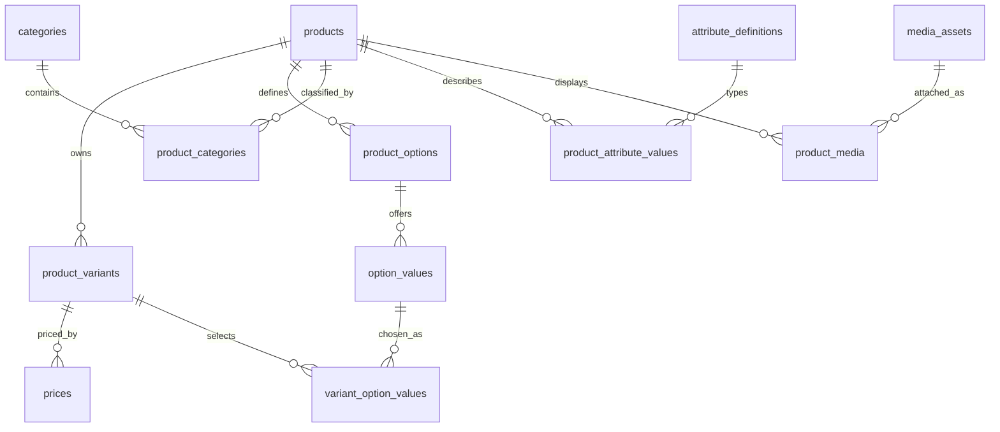

# Catalog and media schema — Task 03B

Implemented 2026-11-10 in `src/server/db/schema/{catalog,media,catalog-media}.ts` and additive migration `drizzle/0001_catalog-media.sql`. This adds 17 tables to the 16 identity/customer tables. Only disposable synthetic PostgreSQL databases have been migrated; existing routes still use their previous persistence.

## Ownership and relationships

| Table | Responsibility and key constraints |
|---|---|
| `products` | UUID identity, preserved unique public key, optional unique slug, original Unicode content/SEO, draft/published/archived status, version and internal configuration epoch |
| `product_variants` | Product-owned unique case-insensitive SKU, optional dimensions/weight, draft/active/archived state, at most one non-archived default, derived option combination |
| `product_options` | Product-owned option definitions, unique key per product, ordered names |
| `option_values` | Ordered choices belonging to a specific option and product, unique key per option |
| `variant_option_values` | One selection per variant/option; composite foreign keys prevent mixing products or options |
| `categories` | Unique category key, optional parent, ordered/archive metadata; self-parenting and recursive cycles rejected |
| `catalog_taxonomy_guard` | One infrastructure row, ID 1; serializes category writes so concurrent edits cannot create cycles |
| `product_categories` | Unique product/category membership, at most one primary category per product |
| `activities` | Unique activity keys and original names; distinct from staff audit events |
| `product_activities` | Unique product/activity membership, reverse lookup index |
| `attribute_definitions` | Unique normalized key, type `text`, `number`, `boolean` or `enum`, unit/filterability |
| `attribute_enum_values` | Unique choice per enum attribute; definition/type foreign key prevents choices on other types |
| `product_attribute_values` | One value per product/attribute; exactly the payload matching its definition type; enum membership enforced |
| `product_relations` | Directed related/accessory/upsell links; unique source/target/type; no self-link or missing product |
| `prices` | Variant-owned KZT amounts, market, optional compare-at amount, active flag/version/time; one active row per variant/market/currency |
| `media_assets` | Unique storage namespace/key, source path, kind, private/pending defaults, checksum/bytes/MIME/dimensions/alt metadata |
| `product_media` | Ordered product gallery or variant gallery; composite ownership FK, unique asset membership and at most one primary per scope |

Product/category/relation and media ownership links use restrictive deletion. Archive linked records rather than cascading deletion. Relationships are directed; creating a reciprocal recommendation is an explicit service action.

## Variant configuration and concurrency

A simple product has no options and one default SKU; its completed option signature is an empty UUID array. Draft products may temporarily have no variants; the database enforces **at most one** current default, while the later catalog service must enforce a usable default when publishing. Never manufacture a SKU to satisfy an unresolved historical import.

Selections reference both their option and product. A deferred constraint trigger derives a sorted UUID array from selected values. Incomplete draft configurations have a null signature; active variants must select every defined option. Completed non-archived combinations must be unique. Applications must not write `option_signature`; direct changes are rejected.

Configuration mutations update the owning product's `configuration_epoch`, serializing concurrent writers, including stale repeatable-read writers. At deferred validation, the function first checks whether the product is already canonical. If rebuilding is needed, it clears that product's old signatures and derives the entire final set before commit. This permits atomic swaps of two combinations while duplicate final combinations still roll back. Intermediate cleared signatures are transaction-local. Subsequent deferred callbacks skip the already-canonical set.

The taxonomy singleton uses a real epoch update before category statements, followed by recursive ancestor validation. Tests cover competing category reparenting at read committed and repeatable read. These locks protect infrequent catalog edits, not future inventory/checkout hot paths. Future bulk operations should lock products in consistent order and retry complete transactions on serialization failures or deadlocks, with bounded retries outside the transaction callback.

## Representations and preservation

- Money uses PostgreSQL `bigint` and Drizzle native `bigint`; DTOs serialize canonical integer strings. Amounts are nonnegative; compare-at must be at least the selling amount. USD remains display-only, with FX settings/snapshots arriving in later tasks. No legacy USD-looking source amount has been reinterpreted or imported as KZT.
- Numeric attributes use `numeric(20,6)`; measurements use positive nullable integer grams/millimeters. Timestamps use timezone-aware columns. UUID defaults are generated by the application; direct SQL writers supply IDs.
- Product content retains specs/features/in-the-box/SEO and a restricted `legacy_content` object for original details. JSON checks validate container shapes only. Later import/service validation handles individual entries, sanitation, URLs and public field allowlists. Never return the legacy object wholesale in a storefront DTO.
- Existing Kazakh, Russian and English text is retained without choosing translation tables, fallback rules or localized routing. Language modeling remains a separate owner review.
- Media rows contain metadata, not binary contents. Ready rows require size, MIME and a lowercase SHA-256 checksum; dimensions must be positive pairs. This does not prove the object exists or is safe. Storage access, uploads/content inspection, private serving and cleanup are later service work. Metadata defaults to private/pending.
- Versions and `updated_at` are not automatic SQL optimistic-lock enforcement: Drizzle supplies its update hook, while services must compare/increment versions and direct SQL writers must set timestamps explicitly.

## Service boundaries and future migrations

Publishing must later require an active default variant, authoritative price and suitable ready/public media. Neither setting `published` nor a valid metadata row alone grants storefront availability. Authentication, permission checks, import reconciliation, search/facet query tuning and asset delivery are separate tasks.

Migration 0001 includes custom locking, deferred-signature and cycle-check functions/triggers plus the taxonomy infrastructure row. These bodies are **not modeled in Drizzle's schema snapshot**. Preserve and review them when appending migrations; do not regenerate away custom SQL. Migration 0000 and its consent trigger remain unchanged. No business seed records were added.

The schema is a foundation for the owner's growth targets, not a performance certification. Product count, variant count, query plans, media delivery, concurrent requests and disk/backup growth must be measured in Task 21 before selecting a minimum VPS.
