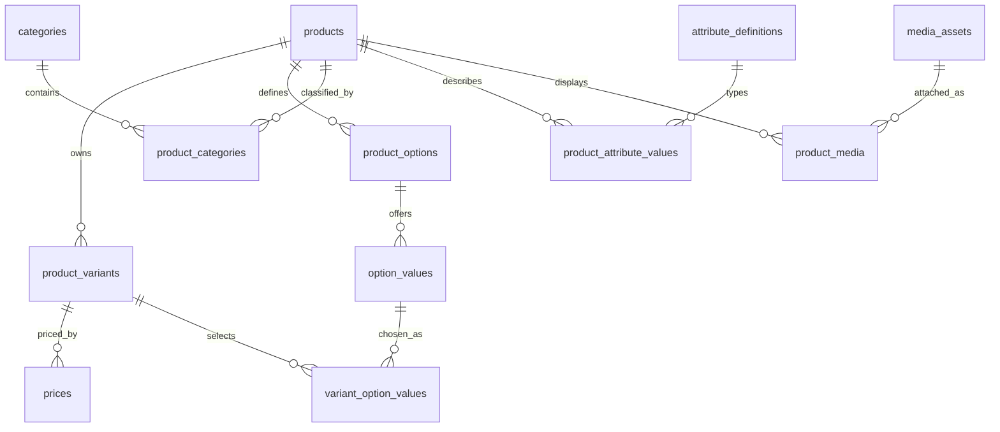

# Catalog and media schema — Task 03B

Implemented 2026-11-10 in `src/server/db/schema/{catalog,media,catalog-media}.ts` and additive migration `drizzle/0001_catalog-media.sql`. This adds 17 tables to the 16 identity/customer tables. Only disposable synthetic PostgreSQL databases have been migrated; existing routes still use their previous persistence.

## Ownership and relationships

| Table | Responsibility and key constraints |
|---|---|
| `products` | UUID identity, preserved unique public key, optional unique slug, original Unicode content/SEO, draft/published/archived status, version and internal configuration epoch |
| `product_variants` | Product-owned unique case-insensitive SKU, optional dimensions/weight, draft/active/archived state, at most one non-archived default, derived option combination |
| `product_options` | Product-owned option definitions, unique key per product, ordered names |
| `option_values` | Ordered choices belonging to a specific option and product, unique key per option |
| `variant_option_values` | One selection per variant/option; composite foreign keys prevent mixing products or options |
| `categories` | Unique category key, optional parent, ordered/archive metadata; self-parenting and recursive cycles rejected |
| `catalog_taxonomy_guard` | One infrastructure row, ID 1; serializes category writes so concurrent edits cannot create cycles |
| `product_categories` | Unique product/category membership, at most one primary category per product |
| `activities` | Unique activity keys and original names; distinct from staff audit events |
| `product_activities` | Unique product/activity membership, reverse lookup index |
| `attribute_definitions` | Unique normalized key, type `text`, `number`, `boolean` or `enum`, unit/filterability |
| `attribute_enum_values` | Unique choice per enum attribute; definition/type foreign key prevents choices on other types |
| `product_attribute_values` | One value per product/attribute; exactly the payload matching its definition type; enum membership enforced |
| `product_relations` | Directed related/accessory/upsell links; unique source/target/type; no self-link or missing product |
| `prices` | Variant-owned KZT amounts, market, optional compare-at amount, active flag/version/time; one active row per variant/market/currency |
| `media_assets` | Unique storage namespace/key, source path, kind, private/pending defaults, checksum/bytes/MIME/dimensions/alt metadata |
| `product_media` | Ordered product gallery or variant gallery; composite ownership FK, unique asset membership and at most one primary per scope |

Product/category/relation and media ownership links use restrictive deletion. Archive linked records rather than cascading deletion. Relationships are directed; creating a reciprocal recommendation is an explicit service action.

## Variant configuration and concurrency

A simple product has no options and one default SKU; its completed option signature is an empty UUID array. Draft products may temporarily have no variants; the database enforces **at most one** current default, while the later catalog service must enforce a usable default when publishing. Never manufacture a SKU to satisfy an unresolved historical import.

Selections reference both their option and product. A deferred constraint trigger derives a sorted UUID array from selected values. Incomplete draft configurations have a null signature; active variants must select every defined option. Completed non-archived combinations must be unique. Applications must not write `option_signature`; direct changes are rejected.

Configuration mutations update the owning product's `configuration_epoch`, serializing concurrent writers, including stale repeatable-read writers. At deferred validation, the function first checks whether the product is already canonical. If rebuilding is needed, it clears that product's old signatures and derives the entire final set before commit. This permits atomic swaps of two combinations while duplicate final combinations still roll back. Intermediate cleared signatures are transaction-local. Subsequent deferred callbacks skip the already-canonical set.

The taxonomy singleton uses a real epoch update before category statements, followed by recursive ancestor validation. Tests cover competing category reparenting at read committed and repeatable read. These locks protect infrequent catalog edits, not future inventory/checkout hot paths. Future bulk operations should lock products in consistent order and retry complete transactions on serialization failures or deadlocks, with bounded retries outside the transaction callback.

## Representations and preservation

- Money uses PostgreSQL `bigint` and Drizzle native `bigint`; DTOs serialize canonical integer strings. Amounts are nonnegative; compare-at must be at least the selling amount. USD remains display-only, with FX settings/snapshots arriving in later tasks. No legacy USD-looking source amount has been reinterpreted or imported as KZT.
- Numeric attributes use `numeric(20,6)`; measurements use positive nullable integer grams/millimeters. Timestamps use timezone-aware columns. UUID defaults are generated by the application; direct SQL writers supply IDs.
- Product content retains specs/features/in-the-box/SEO and a restricted `legacy_content` object for original details. JSON checks validate container shapes only. Later import/service validation handles individual entries, sanitation, URLs and public field allowlists. Never return the legacy object wholesale in a storefront DTO.
- Existing Kazakh, Russian and English text is retained without choosing translation tables, fallback rules or localized routing. Language modeling remains a separate owner review.
- Media rows contain metadata, not binary contents. Ready rows require size, MIME and a lowercase SHA-256 checksum; dimensions must be positive pairs. This does not prove the object exists or is safe. Storage access, uploads/content inspection, private serving and cleanup are later service work. Metadata defaults to private/pending.
- Versions and `updated_at` are not automatic SQL optimistic-lock enforcement: Drizzle supplies its update hook, while services must compare/increment versions and direct SQL writers must set timestamps explicitly.

## Migration 0013: taxonomy kinds, product compatibility, box items

Additive migration `drizzle/0013_taxonomy-compatibility-geo.sql` (also adds the saved-address map pin; see [identity-customer-schema.md](identity-customer-schema.md)). Completed migrations and the 0001 triggers are unchanged.

**`categories`** gains:

| Column | Rule |
|---|---|
| `kind` | `catalog` (default; storefront navigation), `accessory` (accessory tree) or `group` (compatibility groupings such as band fittings and watch series); check `categories_kind_valid` |
| `slug` | Nullable for existing rows, unique (`categories_slug_unique`), lowercase ASCII words joined by `-` with `/` between segments (`categories_slug_valid`), for example `sports-fitness/running-smartwatches` |
| `preset_filters` | JSON object, default `{}` (`categories_preset_filters_object`); keys match the public catalog query: `activities`, `levels`, `caseSizes`, plus `families` (product family) |
| `nav_visible` | Default true |
| `description` | Optional text |

The new columns do not interact with the taxonomy triggers. `catalog_taxonomy_lock` still serializes every category statement, and `catalog_category_cycle` still runs on `parent_id` changes. The database does not enforce which kinds may be parents of which; the seed data does. Seed data lives in `src/server/catalog/taxonomy-seed.ts`: catalog nodes mirror the garmin.com mega-menu, followed by the accessory tree and the groups. It is data only, and this migration inserts no category rows.

**`product_compatibility`** stores one row per "accessory fits device" fact:

| Device scope | Meaning |
|---|---|
| `device_option_value_id` and `device_variant_id` both NULL | Fits every variant of the device |
| `device_option_value_id` set | Fits every current and future variant carrying that value, e.g. fēnix 8, Case size "51 mm" |
| `device_variant_id` set | Fits one device variant only. Use this only for rare exceptions |

`accessory_variant_id` optionally narrows the accessory side to one SKU. The two product columns are mandatory and must differ (`product_compatibility_not_self`). At most one device scope column may be set (`product_compatibility_single_device_scope`). The unique index `product_compatibility_link_unique` covers (accessory product, accessory variant, device product, option value, device variant), with NULLs coalesced to the all-zero UUID. Two different rows can still overlap, for example a fits-all row and a 51 mm row for the same pair. The service should avoid storing redundant rows like that.

Both reads come from the same rows:
- **Compatible accessories for a device variant `v`:** rows for `v`'s product whose scope is NULL/NULL, equals `v`, or is one of `v`'s selected option values. The integration test contains the reference query.
- **Supported models for an accessory:** the rows' `device_product_id` values. Use `product_compatibility_device_idx` for the first read and `product_compatibility_accessory_idx` for the second; both are ordered by `position`.

Ownership is enforced by composite foreign keys, the same pattern `variant_option_values` uses, so no trigger is needed:
- `(accessory_variant_id, accessory_product_id)` → `product_variants(id, product_id)`
- `(device_variant_id, device_product_id)` → `product_variants(id, product_id)`
- `(device_option_value_id, device_product_id)` → `option_values(id, product_id)`. The new unique key `option_values_id_product_unique` makes this possible. Because `option_values` already references its option by `(option_id, product_id)`, a value matched to the device product always belongs to one of that product's options.

With MATCH SIMPLE, a NULL variant or value skips its check. `catalog_configuration_lock` makes the product of a variant or value immutable, so ownership cannot drift after insert. Changing a row's `device_product_id` re-checks its scope.

Every foreign key uses **ON DELETE RESTRICT**, which reports SQLSTATE 23001. This follows the catalog convention: no service deletes variants or option values, products, variants and option values are archived, and option values are pinned by `variant_option_values` with RESTRICT. A cascade would silently drop a fit fact. A service that really removes an option value must first delete or rescope its compatibility rows. Partial indexes on the three optional FK columns keep these RESTRICT checks cheap. Archiving a variant (editor save or SKU quick edit, `syncProductVariants`) deletes the rows scoped to it on either side and gives the other product version+1 (M9.3 review); the read API never returns rows scoped to an archived variant, and the writer drops (never rejects or widens) a link that still names an archived SKU, so an archived variant can never leave a product unsavable. The older `product_relations.compatible_accessory` type is untouched. New fit data belongs in `product_compatibility`.

**`products.in_the_box`** items may be any JSON string (legacy text, kept as-is) or an object `{label, image?}`. `label` must be a non-blank string, `image` must be a string, and no other keys are allowed. The custom immutable function `catalog_in_the_box_valid(jsonb)` backs the check `products_in_the_box_items`. The array container check `products_content_shapes` is unchanged. The Drizzle type is `InTheBoxItem[]` = `(string | { label: string; image?: string })[]`. Existing rows must already satisfy the check, or the migration aborts. Rows holding only string arrays pass.

## Migration 0014: option display, swatches, admin list support

Additive migration `drizzle/0014_catalog-admin-variant-display.sql`, generated by drizzle-kit. Only the header comment was added by hand. Before it, these values lived only in `products.legacy_content`.

| Column / index | Rule |
|---|---|
| `product_options.display` | `buttons` (default), `swatch` or `dropdown`; check `product_options_display_valid` |
| `option_values.swatch_color` | NULL or a lowercase `#rrggbb` (`option_values_swatch_color_valid`). Services accept `#rgb`/`#rrggbb` in any case and normalize |
| `option_values.swatch_image_source` | NULL or a non-blank path/URL of at most 2048 characters (`option_values_swatch_image_valid`). This is plain text, not a `media_assets` reference: swatch images are often remote garmin.com URLs that are never downloaded, so they cannot be ready media assets |
| `products.thumbnail_source` | `GENERATED ALWAYS AS (legacy_content->>'image') STORED`. The admin list thumbnail fallback (after the primary ready `product_media` image), so list queries never detoast the large `legacy_content`. It cannot be written directly (SQLSTATE 428C9) |
| `products_admin_order_idx` | `(updated_at DESC, id DESC)`, the keyset order of the admin product and SKU lists |

`syncProductVariants` (`src/server/catalog/variant-sync.ts`) changes:
- It writes `display` and the swatches, and `readVariantConfiguration()` reads them back.
- It accepts stored row ids as input ids, so an editor can send back what it read.
- Before removing an option value or a variant, it deletes the `product_compatibility` rows scoped to it. 0013 uses RESTRICT, so the fit fact would otherwise block the removal. A fact scoped to something that no longer exists describes nothing.

## Product writes and compatibility ownership (M2)

The PostgreSQL CMS has a single product writer, `writeProduct` in `src/server/cms/catalog-write.ts`. It is used by `/api/admin/products` and `/api/admin/catalog/products`, and saves everything in one transaction:
- the product row;
- `legacy_content`, rebuilt from the stored result in the legacy CMSProduct shape with stored ids, for back-compat readers;
- options, variants, prices, media and stock through `syncProductVariants`. Stock goes through the ledger with the staff user as actor and source `admin:<public key>#<variant>`;
- `product_categories` (replaced as a set, exactly one primary);
- `product_relations` (`related` / `upsell`, replaced per type);
- `product_compatibility`.

Stock is the on-hand level at `main`. A level equal to its `stockBaseline` (the value the editor loaded) is never written. A changed level whose baseline no longer matches the ledger is a 409 `STOCK_CONFLICT`. Changing stock or creating a product needs `inventory:write`.

**Compatibility ownership rule (decision D-C1).** Each fact is one row, readable and writable from both products:
- **Accessory side** (`compatibility.devices` on the accessory's command) owns every row whose `accessory_product_id` is that product, in every device scope (whole device, option value, device variant) and with or without an accessory variant. The read API returns all of them in the same command shape, so an editor that sends back what it read keeps every row.
- **Device side** (`compatibility.accessories` on the device's command) owns only rows whose `device_product_id` is that product and whose device scope is whole-device (no option value, no device variant). Finer rows, such as "51 mm only" or "one SKU only", can be written only from the accessory side, so saving the device editor never deletes them.
- **No redundant rows.** After every write, a row is deleted when another row for the same accessory/device pair covers it. Whole device covers option value, which covers the device variants carrying that value; a row without an accessory variant covers every accessory variant. A whole-device row added from the device side therefore replaces a "51 mm" row for the same pair. If it is later removed from the device side, the pair has no row left.
- **No silent overwrite across editors.** When a save changes the rows visible from the other product (insert, delete or collapse), that product's `version` is bumped. Its open editor gets 409 and reloads instead of sending back a stale list. Two products saving each other at the same moment can deadlock; this surfaces as a 409 "try again".

Read shape: `compatibility.devices` / `compatibility.accessories` are the command echo, with option values as stored ids. `compatibility.compatibleDevices` shows each device's name, thumbnail, primary category, option values with variant counts, and SKUs. `compatibility.compatibleAccessories` shows each accessory with its scope and `appliesToVariantIds`, which is resolved per device variant, so new variants carrying a linked option value are included automatically. The legacy top-level `compatibleAccessories` (a list of cross-sell ids) is unchanged and stays in `legacy_content` only.

## Service boundaries and future migrations

Publishing must later require an active default variant, authoritative price and suitable ready/public media. Neither setting `published` nor a valid metadata row alone grants storefront availability. Authentication, permission checks, import reconciliation, search/facet query tuning and asset delivery are separate tasks.

Migration 0001 includes custom locking, deferred-signature and cycle-check functions/triggers plus the taxonomy infrastructure row. These bodies are **not modeled in Drizzle's schema snapshot**. Preserve and review them when appending migrations; do not regenerate away custom SQL. Migration 0013 adds one more such object, the `catalog_in_the_box_valid` function and its `products_in_the_box_items` check. Migration 0000 and its consent trigger remain unchanged. No business seed records were added.

The schema is a foundation for the owner's growth targets, not a performance certification. Product count, variant count, query plans, media delivery, concurrent requests and disk/backup growth must be measured in Task 21 before selecting a minimum VPS.
