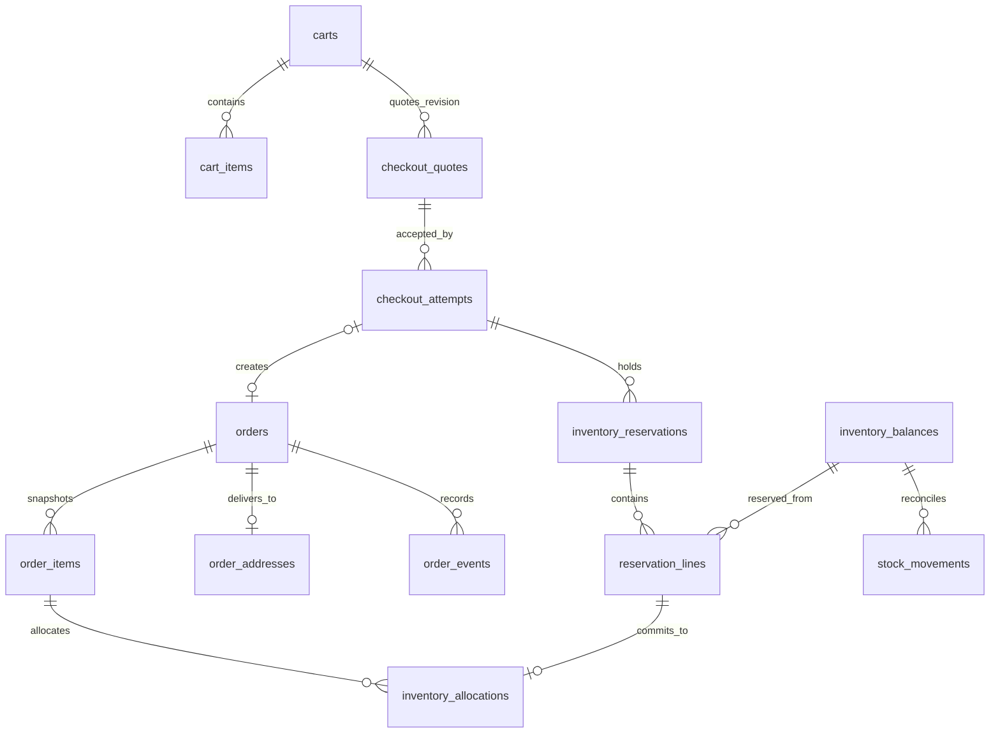

# Inventory, carts and orders — Task 04A

Implemented in `src/server/db/schema/{commerce,inventory}.ts` and additive migration `drizzle/0002_commerce-inventory.sql`. Sixteen tables and an order-number sequence extend the existing 33 tables to 49. This is schema groundwork; no route/service uses it yet and no real records have been imported.

## Data ownership

| Table | Responsibility and constraints |
|---|---|
| `stock_locations` | Private warehouse/location identity, unique key, archive timestamp |
| `inventory_balances` | One sellable balance per variant/location; nonnegative on-hand and reserved, reserved <= on-hand, positive version |
| `inventory_reservations` | Checkout-owned temporary hold, optional matching order, active/consumed/released/expired, required expiry, terminal evidence/time |
| `reservation_lines` | Immutable positive quantities, unique reservation/variant/location, FK to an existing balance |
| `inventory_allocations` | Paid allocation for an order item and consumed reservation line; same variant/location/quantity, one allocation per line; bounded monotonic restoration counter |
| `stock_movements` | Append-only signed on-hand/reserved deltas, reason, business-event dedupe key, optional matching reservation/allocation, actor and actual/recorded times |
| `carts` | Exactly one user or SHA-256 guest capability hash, market/KZT, active/converted/merged/expired, version/expiry and private line-lock epoch |
| `cart_items` | Unique variant per cart, quantity 1–99, restrictive ownership, at most 100 lines |
| `checkout_quotes` | Immutable cart ID/revision/hash, structured contact/delivery/line/policy/optional USD snapshots, exact KZT components and expiry |
| `checkout_attempts` | Quote/cart/revision ownership, server-derived actor scope, scoped operation/key/request hash, pending/committed/failed result |
| `orders` | Unique preserved/sequence-generated number, optional verified user/profile and unique checkout association, contact/financial/policy/FX snapshots, independent lifecycle summaries |
| `order_addresses` | At most one immutable structured delivery or explicit raw historical address per order |
| `order_items` | Immutable product/SKU/name/options/quantity/unit-price/discount/tax/total snapshots; optional historical catalog links with composite ownership FK |
| `order_adjustments` | Immutable discount/tax/shipping explanation and source snapshot; optional item must belong to the same order |
| `order_events` | Append-only deduplicated actual event evidence; internal by default; occurred time nullable when unknown, recorded time separate |
| `order_access_tokens` | Order-scoped hashed capability, restricted receipt/status scope, expiry and revocation |

All history-bearing foreign keys restrict deletion. Catalog/account edits cannot rewrite purchased names, prices or delivery details. Customer ownership is a nullable user/profile link distinct from contact text; only future verified claim services may set it. No lookup by entered email/phone grants access.

## Stock semantics and transaction responsibilities

`on_hand` means remaining **sellable** stock, excluding paid allocations even before dispatch. Available stock = on-hand minus reserved. Reservation increases reserved; consumption reduces both on-hand and reserved; release only reduces reserved. Dispatch must not subtract the paid units again. Restoring a paid allocation is a separate deduplicated compensating movement after fulfillment checks.

Balances use bounded PostgreSQL integers. Monetary values use `bigint`, never JavaScript-number arithmetic. Stock movements separately record signed on-hand and reserved changes; at least one delta must be nonzero. Dedupe keys identify a business effect including the line/location where appropriate. Optional source references must match the movement's variant/location; when both a reservation line and an allocation are supplied, the allocation must reference that exact line. Ledger update/delete/truncate is rejected.

Reservation headers have a single terminal transition; terminal headers and line quantities cannot be rewritten. Lines can be inserted only while the header is active. A paid allocation requires a consumed reservation associated with the same order and matching line quantity/variant/location. Restoration may only increase up to the allocated quantity; it is not proof that an eligible cancellation/return occurred.

**Services still must atomically** lock sorted balances, conditionally adjust counters, insert movements/holds/allocations, reconcile aggregates and apply permitted lifecycle transitions. Inserting a ledger row does not automatically alter a balance; inserting a reservation does not automatically reserve units. No scheduler, payment capture, automatic reservation duration, return restock or shipment logic runs in this task. Expiry is indexed, not an automatic timer. Paid allocation totals versus order quantities and shipment claims require the planned service locks and tests.

## Cart and checkout concurrency

An active user cart is unique by user/market/KZT; a guest cart stores only a unique lowercase SHA-256 hash. Secure cookie creation, token verification, expiry enforcement and one-time login merge are future services. A merged cart references its destination; cross-cart merge cycles/eligibility remain service policy.

Each item mutation updates its parent's `line_epoch`, serializing writers. A deferred count guard rejects a 101st line; stale repeatable-read writers receive serialization failures rather than bypassing the cap. Item ownership cannot be changed in place. The aggregate `version` remains the service's optimistic-lock contract: the epoch does not itself increment that version or validate whether a product is sellable.

Quotes retain immutable KZT arithmetic and the optional manually priced USD display snapshot. JSON checks enforce container shapes; later pricing/runtime validators require exact entries, hashes, contact/address agreement, policy versions, FX fields and a current cart version. USD never becomes settlement currency.

Attempts reference an exact quote/cart/revision tuple. The operation/key is unique within the server-derived actor scope, with a required canonical request hash. A partial unique index permits only one pending/committed winner for a cart revision; failed attempts retain their original key/hash while another key can retry. A committed attempt cannot be failed/reopened. Persisting an order atomically marks its pending attempt committed at snapshot sealing. Matching-key replay, actor authorization and provider calls remain future service logic; a constraint violation alone is not an HTTP idempotency implementation.

## Preserved order snapshots

New order numbers default to `GRM-` plus PostgreSQL `order_number_sequence` (starts at 1000001), with an independent unique constraint. Explicit existing numbers are preserved. Gaps after rollback are normal. Task 07 must reconcile imported sequence-style numbers and advance the sequence safely during the rehearsed write freeze; never replace this with `MAX()+1` during checkout.

Provision the future runtime role with sequence `USAGE` as well as the required table DML; table grants alone do not permit `nextval`. Keep sequence administration and schema changes on the migration/operator role.

A new order starts unsealed. In the same transaction, write its header, address, items and optional adjustments. At deferred commit validation, a complete order needs a structured address, at least one line, and component sums matching its fixed header. Item total = unit price × quantity − discount + tax. Header total = subtotal − discount + shipping + tax; tax also reconciles line tax plus any stored shipping-tax component. Numeric intermediates prevent multiplication overflow before comparison with stored bigint totals. Adjustment rows explain amounts already allocated into totals; they do not add a second charge.

The deferred trigger seals both complete and explicitly incomplete historical orders. Snapshot child updates/deletes are always rejected, and further inserts after sealing are rejected. Headers cannot change purchase fields or unseal. Only lifecycle summaries, version/timestamp and verified ownership links remain mutable. Order headers, children, quotes, events and ledgers block truncate/delete as applicable. Services must still enforce permissions, legal lifecycle transitions, version comparison/increment and audited claims. Drizzle update hooks do not make arbitrary SQL writes update timestamps automatically.

Historical rows use `data_quality='legacy_incomplete'`, retain original restricted summary JSON, may omit unsupported components/phone/placed time, and may have no reconstructable lines. A known KZT total is still required. Unknown currency/totals belong in protected staging until resolved; do not invent a zero, a SKU, tax allocation or a payment fact. Unresolved historical catalog links can remain null. Missing actual event times remain null instead of using import time as an asserted event occurrence.

Defaults are pending-payment/unpaid/unfulfilled with demo mode. These summary fields are not financial evidence; payment/provider ledgers arrive in 04B and their services later. Private warehouse fields, source summaries, hashes and internal event payloads must stay out of customer DTOs. An event's customer flag alone does not make every payload safe to serialize.

## Migration and verification boundary

Migration 0002 appends to unchanged 0000/0001. Its generated DDL/snapshot coexist with custom functions for line caps, immutable snapshots/sealing, terminal reservations, allocation ownership and ledger sources. Drizzle snapshots do not model those functions/triggers: preserve and review the custom SQL in future migrations. No business records are seeded.

Tests use synthetic data on disposable PostgreSQL 18.6, including upgrade from prior identity/catalog data, replay, last-unit contention, final cart-slot contention, exact bigints, checkout races and immutable history. They establish schema behavior, not throughput, production security or a minimum VPS size. Task 21 still owns representative performance measurement.
