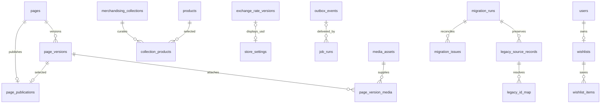

# Content, configuration and operations — Task 04C

Schema reference, 2026-11-11. Implemented in `src/server/db/schema/{content,configuration,operations,wishlists}.ts` and additive migration `0004_content-operations.sql`. This adds 29 tables, bringing the schema to 94 tables. All work remains disconnected from the existing app; no real records, providers, worker or settings have been activated.

## Ownership and relationships

| Tables | Responsibility |
|---|---|
| `pages` | Stable key/kind/slug and draft/published/archived aggregate, optimistic version and internal publication epoch |
| `page_versions` | Immutable title/subtitle/summary/body/blocks, schema version, SEO, original metadata and author; same-kind page FK and unique page/version |
| `page_publications` | One current pointer per page; composite FK prevents pointing at another page's version |
| `blog_posts`, `banners` | Typed immutable version metadata: original author/category/reading-time/cover, or position/order/CTA/image; correct page kind enforced |
| `page_version_media`, `page_version_collections` | Version-owned media roles/order and curated collection references |
| `merchandising_collections`, `collection_products` | Stable curated collection, ordered unique product links and presentation metadata; charged price is not stored here |
| `redirects` | Unique source path, internal target, explicit supported redirect code, inactive default |
| `exchange_rate_versions` | Immutable manual positive finite KZT per USD, decimal `numeric(20,8)`, version/editor/time |
| `shipping_policy_versions`, `shipping_rates`, `shipping_zones` | Versioned KZT tariff bands with quantity/weight bounds and zone criteria; first activation seals the policy |
| `tax_configuration` | Immutable explicit inclusive/exclusive policy version, basis points and optional country/rules; no assumed jurisdiction/rate |
| `store_settings` | Singleton typed store/contact/SEO/display/payment/maintenance settings and explicit current FX/shipping/tax references; restricted original settings |
| `audit_events` | Append-only actor/legacy attribution, target, redacted changes and actual/recorded times; durable dedupe |
| `outbox_events` | Immutable versioned domain-event facts, stable ID/dedupe/topic/aggregate/payload |
| `job_runs` | Per-consumer or standalone durable job state, unique kind/key or kind/event, attempts/replay link, finite hashed leases and ready/lease indexes |
| `webhook_inbox` | Private exact body bytes/hash/context, verification and processing state; provider identity unique only after verification |
| `idempotency_records` | Unique actor/operation/key, immutable request hash, terminal result and explicit retention expiry |
| `export_jobs` | Immutable requester/kind/filter scope, private result identity, lifecycle/expiry; result link remains after expiry |
| `notification_deliveries` | Deferred-by-default email delivery record, dedupe, fixed recipient/purpose/payload, consent evidence and optional provider result |
| `migration_runs` | Source namespace/version/checksum, private archive, counts/manifest and completion/issue gate |
| `legacy_source_records` | Immutable restricted credential-excluded record payload/checksum/source key per run |
| `legacy_id_map` | Stable unique source identity to target UUID/type, linked to the exact staged record/run/entity/key |
| `migration_issues` | Source-field warning/blocker, safe message and immutable resolution evidence; no raw sensitive values |
| `wishlists`, `wishlist_items` | One authenticated-user wishlist and unique product membership; no guest merge policy inferred |

## Content preservation and publishing

Create a content version and its typed metadata/media/collection links in one transaction. A deferred trigger seals the version at commit. Later updates, child additions/deletions or direct unsealing are rejected. Blog/banner versions must have their matching typed metadata. SEO is version-owned here and remains product-owned in the earlier catalog schema; there is no competing polymorphic SEO row to synchronize.

Homepage heroes/carousels/tiles, their source display fields, layout flags, original text and raw metadata fit schema-versioned `blocks`/`legacy_content`. Existing MARQ/editorial/static files remain in Git until the owner requests their CMS extraction. Preserving a source price string inside a restricted block does not make it the charged price: live product cards must read authoritative catalog/availability DTOs.

A published page needs a same-page version pointer. Pointer mutations update the page epoch before validation; truncate cannot bypass the relationship. Later publish services must atomically write pointers/status/audit/outbox and handle version conflicts. Public queries must also check publication windows, archived/draft status, media readiness and collection visibility. No scheduler or HTML/link sanitizer is implemented here. JSON checks enforce container shapes, not the complete block schema or safe rendering. Redirects still require a proper URL/path validator and cycle checks in their future service.

Language-specific tables, localized slugs, fallback/routing and translation strategy are deliberately absent. Original Kazakh/Russian/English Unicode text is retained unchanged.

## Explicit policy versions and settings

USD display points at an immutable manually authored KZT-per-USD rate. PostgreSQL numeric `NaN` is explicitly rejected as well as nonpositive values. Enabling display requires a real FK reference; no rate is seeded. Decimal arithmetic, rounding, author permissions, cache invalidation and immutable quote/receipt FX snapshots remain the later pricing/settings services. Settlement stays KZT.

Shipping rate rows and policy identity are immutable. A draft policy can acquire bands until first selected in settings; selection seals it permanently. Band insertion performs a real parent write, so stale repeatable-read activation cannot miss concurrent changes. Zones used by sealed policies cannot change; create a new definition/version. Historical tax and shipping facts remain order snapshots, independent of active settings.

No tax/receipt/free-shipping/market rule was invented. New policy records require explicit values, active policy pointers are nullable, and settings default to demo/maintenance. Those defaults do not alter the current app because no settings row is seeded or read by it. Original currency labels/provider flags/tax fields remain restricted source evidence until confirmed. No secret belongs in a JSON setting.

## Durable work, receipts and idempotency

Immutable outbox facts are separate from mutable delivery jobs. A future service must write its business change, event and required job in the same transaction; these tables do not automatically enqueue work. A consumer/event pair is unique. Workers must claim bounded batches using a lock/conditional update, compare the expected hashed lease token on every completion, and apply idempotent effects before acknowledgment.

Claims increment attempts, use finite future deadlines and cannot steal a live token. Same-token renewal requires an unexpired lease. Expired work can be reclaimed with a fresh token and incremented attempt. Exhausted work must dead-letter rather than return to an unclaimable pending queue. Terminal job identity/results cannot be rewritten; replay is a new row linked to the old job. Schema state does not prove that a worker ran or an external effect succeeded; Task 12 owns execution, supervision, retries and atomic fencing predicates.

Webhook body `bytea` preserves exact bytes for later signature verification. Context/body/hash are immutable. Unverified event IDs do not occupy the verified uniqueness index, preventing an unsigned receipt from blocking a legitimate event. Queued/processed state requires stored verified evidence; this flag is not cryptographic proof. The future provider handler must verify bytes/signature/merchant/environment/amount, compute/check hashes, bind the event ID, create jobs and acknowledge durable intake. Receipt rate limits, payload-size bounds, restricted access and retention remain handler/operations work.

Generic idempotency request identity/hash are fixed. Completion stores a terminal private result; expiry cannot be shortened to defeat retention. Ordinary deletion is permitted only after expiry for completed/explicitly abandoned records, and truncation is blocked. Provider-specific retention and the decision that an unknown operation is safely abandoned require the future reconciliation service.

## Private outputs and consent boundaries

Exports retain their requester, scope and first result identity through expiry. A result/archive must reference ready private media. Result/archive links cannot be removed/replaced, and referenced assets cannot become public. A real asset-row write serializes these checks against concurrent changes, including stale repeatable-read writers. This protects metadata consistency; storage ACLs, object deletion after expiry, authorization on every download, redaction and CSV formula protection remain later services. Keep metadata links when expiring/deleting binaries.

Notification sending defaults to `deferred`; no sender is deployed. Marketing evidence must be an email grant for marketing/newsletter, joined to the recipient profile's recorded email and linked user (including a null user for an unlinked profile). Another profile/purpose cannot authorize the row. Before dispatch, services still must verify the contact and recheck current policy/withdrawals/preferences. An old grant is not proof of current permission, and importing an email does not subscribe it. Transactional delivery is a separate purpose.

## Every source field has a preservation path

[`schema-source-dispositions.json`](schema-source-dispositions.json) inventories all **160 observed paths, 358 declared fields across 47 interfaces and 35 static definitions** from Task 01. Each entry names candidate typed domains and/or restricted `legacy_source_records.payload`; it is a schema/preservation disposition, not a completed value mapping or executed import. Original files/assets stay retained. Refresh the inventory before real extraction and resolve per-field conflicts in Tasks 06–07.

Credentials are excluded from business staging. The known `admins.password` field is rejected; extraction must recursively exclude secrets rather than rely only on that defensive check. Original sensitive backups stay separately protected. Unresolved money/country/owner/actor/timeline values are retained without reinterpretation. Optional device/subscription/support records stay restricted until their ownership/activation review, instead of requiring fabricated active tables now.

Import mappings bind exact source/run/entity/key provenance and cannot silently remap identity. Their polymorphic target UUID/type requires a validated target registry in the importer; no generic SQL FK can prove all target tables. Stage/issue writes serialize on their run. Finished runs cannot acquire further evidence, and unresolved blockers prevent completion. Count conservation, source checksum calculation, owner-approved quarantine and target-field validation are still Task 06–07 gates; a `completed` row alone is not a production import certificate.

## Migration and operational limits

0004 appends to unchanged 0000–0003. All 65 earlier table definitions remain unchanged. Preserve custom SQL guards not modeled in Drizzle snapshots, including newly added media privacy guards on the existing media table. Narrow runtime DML grants must support internal publication/run/policy/asset writes; DDL remains separate. Ordinary immutable history is deletion/truncate-protected. Privileged retention, backup/restore and capacity qualification need their later runbooks.

Real PostgreSQL tests cover empty/prior upgrades and replay, Unicode snapshots, ownership, finite FX, lease contention/expiry, verified dedupe, private-output retention, consent binding, import keys and shipping activation races. They do not establish production throughput, privacy authorization, provider readiness or a minimum VPS size. Existing customer/admin routes continue using their prior backend until the later integration tasks.
