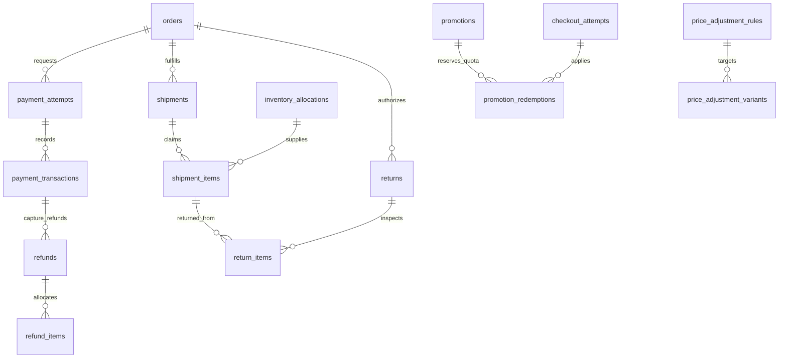

# Payments, manual fulfillment and promotions — Task 04B

Completed schema reference, 2026-11-11. Sources: `src/server/db/schema/{payments,fulfillment,promotions}.ts` and additive `drizzle/0003_payments-fulfillment-promotions.sql`. Sixteen new tables extend 49 prior tables to 65, without changing their snapshot definitions. No real data, routes or external providers have been switched to this schema.

## Ownership and connections

| Table | Responsibility and constraints |
|---|---|
| `payment_attempts` | Order-owned full KZT payable amount, provider/environment/merchant context, stable request hash/key/reference and optional provider session; one active payable attempt per order |
| `payment_transactions` | Immutable authorization/capture/void facts, matching attempt/order/context, unique provider external identity and business dedupe key, actual/recorded times; private refund serialization epoch |
| `refunds` | Request against a capture of the same order/context, fixed positive amount/key/hash, provider refund reference, reserved/pending/unknown/succeeded/failed/cancelled state |
| `refund_items` | Immutable item or shipping/adjustment allocation, positive item quantity and exact net/discount/tax arithmetic; item must belong to the refund's order |
| `shipments` | Manual/internal order-owned draft/ready/dispatched/delivered/cancelled shipment, private carrier/tracking/notes, namespaced external identity and actual timestamps |
| `shipment_items` | Fixed claims against the same order item/allocation; positive quantities and one line per allocation/shipment; private return serialization epoch |
| `shipment_events` | Append-only staff/source event evidence, source ID and dedupe key, actor, nullable actual occurrence time and separate recorded time |
| `returns` | Order-owned request/key/requester/reason, independent authorization/receipt/inspection/closure states and actual evidence timestamps |
| `return_items` | Same-order shipped item, fixed requested quantity, bounded monotonic received/accepted/restocked counts, inspection decision and destination location |
| `promotions` | Unique lowercase trimmed code, preserved optional original code, fixed KZT or percentage basis points, targets/schedule/stacking/limits/version and preserved legacy usage baseline |
| `promotion_categories` | Unique coupon/category target with restrictive foreign keys |
| `promotion_variants` | Unique coupon/variant target with restrictive foreign keys |
| `promotion_redemptions` | Checkout/order association, optional authenticated user or opaque verified-subject hash, fixed KZT discount, reserved/used/released/expired evidence and expiry |
| `price_adjustment_rules` | Separate admin markdown definition, fixed KZT or percentage basis points, target scope, explicit activation/schedule/version; nonstackable by default |
| `price_adjustment_categories` | Unique markdown/category target |
| `price_adjustment_variants` | Unique markdown/variant target |

All history-bearing links use restrictive deletion. Header identities, financial facts, item claims and evidence are protected from rewriting/deletion; the migration also blocks truncating history tables. Ordinary corrections use the future audited workflows and new evidence, not silent deletion of facts. Exceptional operator/retention actions need separate design.

## Payment attempts and facts

Provider codes are the existing `demo`, `kaspi` and `secondary` interface boundaries, not an assertion that a specific API is connected. Context includes `demo`/`sandbox`/`live` and a nonsecret merchant-account identifier. External sessions, merchant references and request keys are unique within provider/environment/merchant context. Transactions additionally scope external identity by kind because an authorization and capture may share a provider reference. The generic webhook inbox/delivery identity belongs to 04C and Task 15; it is not approximated by a transaction row.

Attempts in created/pending/requires-action/authorized/unknown states occupy the one-payable-attempt index. Unknown provider outcomes therefore block replacement. Terminal attempts cannot reopen into payable states. Session IDs latch on first assignment; the attempt's order, amount, request hash/key and context are immutable. A new attempt matches its order's full amount and demo/non-demo mode. An order-row lock plus the unique index serializes creation.

Authorization/capture/void rows contain positive KZT amounts, fixed context and dedupe identity. Demo cannot create those rows or assert capture/authorization attempt states. A simulated result is not cash. Sandbox and live facts remain explicitly distinguished; future reports must select the correct environment/merchant and count captures rather than authorizations/voids as captured cash.

Actual financial outcomes can differ from the expected order amount, so transaction facts are not capped by the order's total: later reconciliation must retain overpayments/late outcomes and resolve exceptions, rather than discard money evidence. Nothing in this schema verifies a provider signature, authorizes a caller, changes an order to paid, consumes stock or triggers fulfillment. Provider verification, amount/merchant/environment checks, safe late-capture handling, retries and reconciliation are Task 15 services. Private `evidence` is an object container only; validators must select safe fields and never retain credentials or card secrets.

## Refund reservations and allocation

A refund requires a capture, with matching order/provider/environment/merchant context and an amount no greater than that capture. Reserved, pending, unknown and succeeded amounts all count against its refundable balance. Failed/cancelled requests release capacity; succeeded/failed/cancelled outcomes cannot be reopened. Request identity/amount/hash stay fixed; a provider refund ID latches on first assignment.

The guard increments the capture's internal `refund_epoch` before counting other requests. Financial fields remain immutable; only nested guard updates may change that epoch. This serializes read-committed writers and forces stale repeatable-read writers to fail with `40001`, preventing two distinct requests from claiming the same refundable remainder. No external network call belongs inside that transaction; services must retain an unknown reservation until a definitive outcome is established.

Refund item rows belong to the same order and satisfy amount = net − discount + tax. They can be inserted only while the request is reserved, then remain immutable. Services still need to validate purchased/refundable quantities, reconcile all allocation rows with the requested refund, preserve original rounding remainders and check policy/permissions before submission. A refund never automatically restocks an item.

## Manual shipment claims and returned stock

Shipments begin as drafts. Items are immutable planning claims against an allocation of the same order item; inserting a claim locks the shipment and increments the allocation version before summing claims. Draft and ready claims count, preventing two shipments from claiming the same paid units. Cancelling an undispatched shipment releases its claims. Dispatched shipments cannot be cancelled into free stock; their units use returns. Forward state changes serialize on the same allocation rows, and actual dispatch/delivery timestamps cannot be replaced once recorded.

Two bounds apply to a new claim:

1. Gross non-cancelled shipment quantities including the new claim cannot exceed the original allocation quantity. Returned units cannot be dispatched again through that original allocation, even if restoration counters have not caught up.
2. Net shipment claims subtract inspected/restocked return quantities and must fit the allocation quantity minus its restored count. This permits the untouched remainder of a partially shipped allocation to ship after the earlier unit was returned.

Restoration uses the corresponding net-claim check. It cannot overlap unreturned claimed units. Inspection/restock counters are monotonic, require received/accepted evidence and a destination, and are not automatic stock mutations. Return requests count against their originating shipped line until rejected/cancelled; concurrent requests cannot reserve more than was shipped. Return identity, requested quantity and actual inspection timestamps cannot be rewritten.

Services must atomically combine these counters/claims with stock movements, stock balances, financial state, permissions and durable events. If a return restocks to a different location, the future stock service must use the return item's validated source/destination and a stable dedupe/source reference; the older movement allocation pointer permits only the allocation's original location. The return ID/destination fields do not by themselves create a ledger movement. Shipment/return states and events remain internal; carrier fields, notes and warehouse data must not appear in customer DTOs. No carrier adapter is enabled.

## Coupons and admin markdowns

New codes must already be lowercase/trimmed at the database boundary; future handlers normalize input and preserve original source code in `legacy_code` where needed. Fixed values are positive KZT minor units. Percentages are integer basis points from 1 through 10000. Missing or conflicting value types are rejected. Schedules are ordered; new records default to draft/nonstackable. Coupons and automatic admin markdowns are distinct entities.

Coupon reservations update the promotion's private `usage_epoch` before counting reserved/used rows plus `legacy_used_count`. The baseline cannot decrease; imported usage must not be reset merely because no per-checkout history can be reconstructed. One coupon/checkout association is unique. A reserved row can become used/released/expired once; used usage is not silently reclaimed by refunding an order.

Per-customer limits require a server-verified user or opaque subject hash. A hash is a storage representation, not proof of phone possession; clients cannot choose it. Unverified contact text cannot enforce a hard per-person limit. Where historical per-subject usage is unknown, later eligibility/import policy must address that uncertainty instead of inventing individual redemption records.

The DB enforces quota and basic activation/window rules for new reservations. Pricing services still own category/variant eligibility, minimum spend, configured scope/join agreement, stacking and deterministic item discount allocations. Quota rows do not themselves alter catalog prices or order totals. Admin edits need permission, version checks and durable audit from the later operations/service tasks.

## Migration, roles and remaining work

0003 appends to unchanged 0000–0002. Generated schema/snapshot and custom SQL coexist; Drizzle snapshots do not model guards/triggers. Retain the previous consent, cart, snapshot and inventory guards, plus the new payment/refund/fulfillment/quota guards. This migration adds a restoration guard on the existing allocations table without rewriting its prior DDL or snapshot definition. No business seeds or provider credentials are included.

Future runtime grants must permit the guard's narrow epoch/version updates (`payment_transactions.refund_epoch`, `promotions.usage_epoch`, `shipment_items.return_epoch`, allocation versions), plus appropriate reads and domain DML. Those writes execute as the runtime role; table inserts alone are insufficient. Keep DDL on the separate migration role. Do not weaken immutable-fact guards to work around missing grants.

Real-DB tests cover prior-order preservation/replay, one active payment attempt, provider identity deduplication, demo cash rejection, refund contention at read committed/repeatable read, refund ownership, shipment and return quantity races, inspected partial return behavior, quota/legacy usage and separate markdown targets. These tests establish schema behavior, not production throughput or provider readiness. Generic inbox/outbox/audit/settings/import schemas are 04C; route/service integration follows later. Language modeling and the admin-managed USD exchange-rate implementation remain deferred to their planned reviews/tasks.
