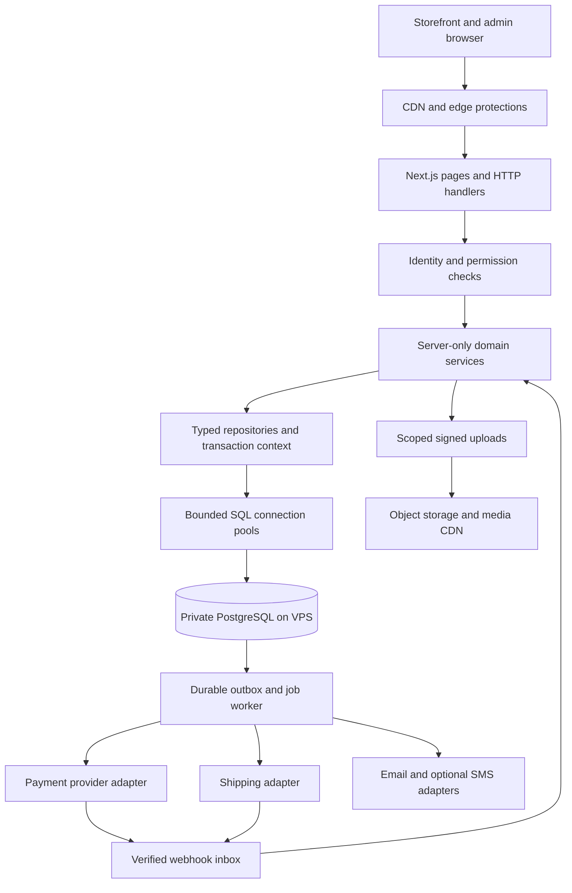
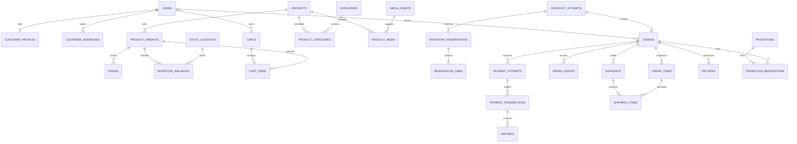

# Ecommerce PostgreSQL Backend Migration — XL Design and Execution Plan

> **For future implementers:** Execute one numbered task per chat using `superpowers:executing-plans`. Do not execute this entire document in one task. Read the relevant design sections and the preceding task's handoff first. Use checkbox steps and explicit task statuses to record progress. Follow a later explicit owner-authorized batch when present. Subagents are optional only when separately authorized; they are not needed for the normal execution path.

**Date:** 2026-11-10  
**Status:** Tasks **01–09 complete** within their recorded scopes. **Next: 10**, authorized; stop before 11. **[Short report for every completed task and current position](../backend/task-progress.md).**
**Code location:** `C:/Users/Freakman/.codex/worktrees/backend-task-02/GRMN`, branch `codex/backend-task-02`. The original `D:/projects/garmin/GRMN` checkout has synchronized progress documents only; backend code is not merged there. Another AI must inspect the active worktree to assess implementation. No commit/merge/push/deployment or real backend activation has occurred.

**Goal:** Replace the current JSON/demo backend with a reliable ecommerce backend for 2,000–5,000 products, over 100,000 registered users, and growing order history.  
**Architecture:** A modular Next.js application and PostgreSQL on VPS infrastructure, with server-only domain services, explicit transaction boundaries, persistent media storage, and a durable background worker. Keep one transactional database and extract services only when measured needs justify it.  
**Proposed stack:** Existing Next.js 16.2.1 / React 19.2.4 / TypeScript; supported PostgreSQL 18; Drizzle ORM + reviewed SQL migrations + `pg`; Better Auth with phone verification subject to pinned adapter/runtime tests; persistent media with off-host recovery; PostgreSQL-backed outbox/jobs initially.  
**Design/spec:** Sections 1–12 of this same document. This is the single XL plan, avoiding a separate spec that could drift from it.  
**Implementation scope:** Sections 13–16. The proposed choices below are recommendations, not decisions already approved by the store owner.

**Owner clarification / Task 01 amendment (2026-11-10):** [Decision register](../backend/decisions.md) and [source manifest](../backend/source-manifest.md) record the authoritative answers and inventory. Three languages (`kk`, `ru`, `en`), localization strategy later; all current business data real and preserved; payments demo now, Kaspi Pay/secondary provider later; manual internal fulfillment; VPS sizing after testing; name/phone/delivery-address quick checkout (email optional), then verified phone account completion; KZT base/payment currency and USD display-only at an admin-maintained manual rate; wishlist/admin discounts/promos required; email/newsletter later; 200–500 daily users, up to 1,000 normally and potentially 5,000 in promotions. This supersedes earlier managed-hosting/demo-record assumptions. This paragraph records the pre-implementation decision point; use the current status above for implementation progress.

## Contents

1. Recommendation and alternatives
2. Verified current state
3. Requirements, assumptions, and capacity targets
4. System architecture and responsibilities
5. Database model and relationships
6. Business rules and transaction flows
7. Application layout and API contracts
8. Performance, caching, and search
9. Security and access control
10. Migration, cutover, and rollback
11. Infrastructure and operations
12. Verification and launch gates
13. Working within usage limits
14. Ordered implementation tasks
15. Owner decisions and later extensions
16. Completion checklist and references

## 1. Recommendation and alternatives

### Recommended approach

Use **PostgreSQL on the owner's chosen VPS with a modular backend inside the existing Next.js application**, plus a separate worker process for durable asynchronous work. PostgreSQL owns customers, catalog, prices, stock, carts, orders, payment records, internal shipping, wishlists, CMS configuration, and audit history. Persistent media storage owns binary assets, with off-host recovery. Auth tooling owns credential/session mechanics, while application services own permissions and commerce rules.

This workload calls for sound relational modeling, bounded queries, reliable transactions, and operational discipline. The stated user count alone does not justify sharding, microservices, Kafka, or a separate search cluster. This is an architectural assessment, not a measured capacity claim.

| Option | Benefits for this project | Costs / limitations | Decision |
|---|---|---|---|
| VPS PostgreSQL + Next.js modules | Reuses current UI/routes; one transactional source; SQL portability; incremental migration; owner-selected hosting | Operator must manage DB updates, volumes, backups, pooling and jobs | Current default per owner |
| Supabase PostgreSQL + Auth + Storage | Consolidates several managed services | Requires deliberate auth/RLS design, provider coupling, and verified regional fit | Good alternative if service consolidation matters most; choose its auth instead of Better Auth |
| Separate API application + PostgreSQL | Useful for independent backend teams, multiple clients, or different deployment needs | Adds deployment, API versioning, authentication, and coordination overhead | Preserve module boundaries so extraction is possible later |

The owner selected VPS hosting; managed PostgreSQL and Supabase remain alternatives only if that decision changes. Choose VPS region, CPU/RAM/disk and off-host backups after representative testing, not from registered-user count alone. A Supabase deployment still uses PostgreSQL; it is a different service bundle, not a competing database engine. Its exposed database API requires carefully designed [row-level security](https://supabase.com/docs/guides/database/postgres/row-level-security).

Use Drizzle for typed SQL access and explicit migrations. Reviewed SQL handles partial indexes, constraints, and locking that deserve direct control. Prisma is also viable, but adopting two ORMs is unnecessary. Drizzle documents [transactions](https://orm.drizzle.team/docs/transactions) and [migration workflows](https://orm.drizzle.team/docs/migrations); exact package versions and adapter compatibility must be verified in Task 01.

### Capabilities used to prepare this plan

- **vibe:** refreshed the local capability inventory, selected relevant capabilities, and organized one XL plan.
- **brainstorming:** inspected the existing implementation, compared approaches, separated known requirements from proposed choices, and requested clarification on market/hosting.
- **writing-plans:** defined bounded tasks, files, dependencies, interfaces, verification, and recovery.
- **Software Architect:** independent read-only review of this document after drafting; final review findings are recorded in Section 16.
- Database, backend, and security concerns are covered within this document; no claim is made that separate skills or specialists were invoked for those concerns.

## 2. Verified current state

Inspection is of the working tree on 2026-11-10, including existing uncommitted work. Do not overwrite those changes when executing this migration. These findings describe source code, not a penetration test or proof of a particular deployed environment.

| Area | Current owning source | What exists / migration implication |
|---|---|---|
| Framework | `package.json`, `next.config.ts` | Next.js 16.2.1, React 19.2.4, Node >=24; standalone build configured; no ORM/database dependency in the root package |
| Primary CMS persistence | `src/lib/cms/store.ts`, `src/lib/cms/data.json` | Synchronous whole-file reads/writes plus process memory; write failures are logged; no DB transactions or cross-instance coordination |
| Stored domains | `src/lib/cms/types.ts` | Admins, clients, products, discounts, banners, blogs, orders, settings, activity logs; homepage configuration is optional |
| Current JSON snapshot | `src/lib/cms/data.json` | 1 admin, 6 clients, 20 products, 4 discounts, 4 banners, 12 blogs, 12 orders, 6 activities; homepage key absent at inspection. Owner confirms all business records are real; preserve them. Seven stored orders contain product refs absent from the CMS product list |
| Additional catalog/content | `src/lib/products.ts`, `src/lib/blog.ts`, `src/lib/marq.ts`, `src/lib/content.ts`, `src/lib/homepage-content.ts`, `src/lib/cms/seed.ts` | Static data, CMS adapters/fallbacks, detailed product content and promotional content coexist; inventory all fields/assets before deleting any source |
| Catalog reads | `src/lib/products.ts`, catalog/product pages, `CatalogueGrid.tsx`, `CompareTool.tsx` | Synchronous CMS lookup and static fallbacks; client imports share product modules. Split public constants from server data access to avoid importing the store/seed into client bundles |
| CMS routes | `src/app/api/admin/**/route.ts` | Collection CRUD exists. Inspected products/orders/homepage handlers do not enforce authentication locally; full route inventory and denial tests required |
| Admin identity | `src/lib/cms/auth.ts`, admin login route | Session is base64 JSON with no signature; password comparison is plaintext, and a missing stored password bypasses that comparison. Replace before production |
| Customer orders | `src/app/api/account/orders/route.ts` | Uses a supplied email filter; without email it returns all orders; no customer identity check in this handler |
| Account | `src/components/AccountDashboard.tsx`, `src/lib/account-addresses.ts` | Embedded profile, addresses, orders, devices, subscriptions; preserve source records as real per owner and establish verified ownership before serving them. Profile/addresses are component state; current helpers enforce five-address limit in UI logic |
| Cart/checkout | `src/lib/cart.tsx`, `src/components/CartView.tsx` | Cart uses localStorage with browser-supplied prices; checkout explicitly displays demo success and clears cart without payment |
| Order lifecycle | `src/lib/cms/order-lifecycle.ts`, `store.ts` | Random-style display order numbers and generated milestones; legacy statuses include both `canceled` and `cancelled`; payment defaults can be `paid` |
| Reports/audit | `store.ts`, admin pages, `src/lib/export/excel.ts` | Dashboard aggregates full arrays; activities are capped at 50 in memory; exports operate on loaded records |
| Existing tests | `tests/*.test.mjs` | Tests cover account addresses, homepage CMS, order filters/lifecycle; no root `test` script at inspection |
| Separate subtree | `FusionCMS/` | A separate CMS codebase is present; root app imports use `src/lib/cms`. No root integration was identified in inspected paths. Confirm ownership before treating it as obsolete |

### Problems this migration must solve

1. Whole-file persistence cannot safely coordinate concurrent stock/order mutations across application instances.
2. Authentication and resource ownership need server enforcement before real personal or payment data is exposed.
3. A customer, a CMS client, an order email, and browser profile currently do not share a durable verified identity.
4. Catalog, prices, rich product content, and homepage cards have overlapping sources that can disagree.
5. There is no implemented real checkout/payment/reservation workflow to simply move into a database; these services must be built.
6. Generated/demo tracking events must never become asserted historical shipping events.
7. Production outages must return explicit errors or safe stale public content, rather than silently showing seed customers/orders or reporting successful writes.

## 3. Requirements, assumptions, and capacity targets

### Global constraints

- Preserve the existing storefront/admin design unless a task explicitly needs a functional integration change.
- Preserve product URLs, blog slugs, order numbers, valid SEO metadata, and existing content; add redirects when a URL changes.
- Use strict TypeScript, no `any`, named exports, 2-space indentation, and server-only database modules.
- Read relevant installed guides under `node_modules/next/dist/docs/` before application changes. Do not assume older Next.js cache, cookies, params, or routing behavior.
- Keep credentials outside Git and client bundles. Use separate local, test, staging, preview, and production data/secrets.
- No automatic schema sync, destructive seed, or production migration during normal application startup/build.
- No microservices, mandatory Redis, replicas, partitioning, or external search at launch without evidence.
- All current business records are real per owner and must be preserved; payment execution is demo. No merchant availability, tax rule, ownership proof or legal requirement is inferred from UI labels/source names.
- This plan does not authorize starting a production cutover or buying infrastructure in this planning task.

### Proposed scope assumptions

One store operator, physical merchandise, KZT as the base catalog/checkout/payment currency with optional USD display conversion, one initial stock location, and room for later warehouses. Languages are Kazakh, Russian and English; translation storage/routing/fallback strategy will be reviewed later, before language implementation. Guest/quick checkout requires name, phone and delivery address to create a provisional profile/order association. Phone verification is required before linking it to a reusable login identity or revealing prior orders. Email is optional for quick checkout; full signup/profile completion requires name, email and phone. Product variants represent the SKU that is actually sold.

Preserve existing Kazakhstan/Singapore/USD source values as real legacy evidence; do not assume one global setting defines every historical amount's currency. Launch KZT and USD display-only are confirmed; historical source currencies, country/tax rules still require confirmation before financial conversion or real checkout. Kaspi Pay and another provider such as Freedom will be connected later; no current live integration is assumed. Staff handle shipping internally, with carrier details hidden from customer DTOs; integrations are deferred. Wishlist, promo codes and admin-managed discounts are required. Email updates/newsletter delivery are deferred. Multi-vendor marketplace settlement is outside initial scope.

### Capacity envelope and acceptance targets

These are **proposed engineering test targets**, not observed traffic, sizing guarantees, or estimates of what 100,000 registered users will do.

Owner forecast: 200–500 daily users, up to 1,000 normally and potentially 5,000 during promotions. These are daily users, not concurrent sessions. The stress envelope below is headroom/growth qualification; launch VPS minimum will be selected from measured representative workloads. No full-capacity disk allocation or 100k-account precreation is required.

| Dimension | Initial design / test envelope |
|---|---|
| Catalog | 5,000 parent products; test up to 50,000 sellable variants and 100,000 product-category/attribute associations |
| Identities | Seed 150,000 synthetic registered users; no production personal data in load tests |
| Purchase history | 1 million synthetic orders / 3 million order items for query and migration checks; generated totals internally consistent |
| Addresses/carts | Up to 5 saved addresses per user; test realistic active carts plus expiry cleanup |
| Active sessions | Exercise 1,000 virtual browsing users with think time; VUs are not simultaneous SQL connections |
| Traffic | 100 HTTP requests/sec sustained for 30 minutes; 500/sec burst for 5 minutes across cached and dynamic routes; separately test 20 checkout creations/sec for 5 minutes with provider mocks |
| Correctness contention | 100 concurrent attempts to reserve the final unit: one succeeds; duplicates of one checkout key produce one order |
| Latency | Same-region origin p95: public uncached reads <300 ms; authenticated reads <400 ms; checkout DB work <800 ms, excluding external provider time; cache-hit public responses <150 ms |
| Reliability | <1% unexpected 5xx under the target workload; business rejections such as out of stock counted separately; zero duplicate charges/orders, negative available inventory, or cross-user leaks |
| Recovery objectives | Proposed production RPO <=15 minutes and RTO <=2 hours, including media recovery; prove by timed restore and choose services to match |
| Availability objective | Proposed 99.9% monthly availability; requires appropriate paid hosting, operations, and alert response, not just a schema |

Record endpoint mix, cache-hit ratio, payload sizes, worker throughput, generator configuration, hardware, region, and DB tier with every benchmark. Test dynamic endpoints separately so a cache-heavy score cannot conceal slow checkout or account queries. Revise this envelope when real concurrency, active users, promotion traffic, and order volume are known.

## 4. System architecture and responsibilities



Payment session creation may be called synchronously after the checkout transaction commits; the same durable payment attempt is retried by the worker if needed. No network call occurs inside a stock/order transaction.

### Module boundaries

| Module | Owns | May consume |
|---|---|---|
| Identity/access | Users, auth adapters, roles, sessions, ownership checks | Customer profile service; no order totals |
| Customers | Profiles, addresses, contact preferences, account linking | Verified principal from identity |
| Catalog | Products, variants, taxonomy, attributes, compatibility, publication | Media IDs; current price/inventory read DTOs |
| Pricing/promotions | KZT prices, manual USD display rates, tax/shipping quote inputs, promo eligibility/redemptions | Catalog IDs, customer eligibility, cart lines |
| Inventory | Balances, reservations, stock movements | Variant IDs and stock locations |
| Cart/checkout | Cart ownership, price quotes, checkout orchestration | Pricing, inventory, orders |
| Orders | Immutable purchase snapshots, order lifecycle, customer history | Verified payment outcomes and shipping events |
| Payments | Attempts, provider IDs, captures, refunds, reconciliation | Orders and provider adapters |
| Fulfillment/returns | Shipments, shipment items, tracking, return authorizations | Paid/approved order quantities, inventory service |
| Content | Pages/homepage, banners, blogs, SEO, redirects | Published product references and media IDs |
| Operations | Outbox/inbox, jobs, audit, exports, metrics, retention | Explicit DTOs and domain events |

Handlers parse/validate, establish identity, call a service, map an error, and return a DTO. Services enforce invariants and transaction boundaries. Repositories perform bounded parameterized queries. Only an orchestrating service opens a multi-module transaction and passes its transaction context to participating repositories. Do not call independent global clients inside that transaction.

Server Components call services directly; do not make an HTTP call to the same app just to read its database. Browser components use HTTP handlers. Both paths invoke the same authorization and validation policy. This follows the installed Next.js guides on a server-only data access layer and public route handlers.

## 5. Database model and relationships

### Shared modeling rules

- Internal IDs: application-generated UUIDs; preserve legacy strings separately in mapping tables. Public product route keys remain compatible with `/p/[id]`.
- All operational timestamps use PostgreSQL `timestamptz` and UTC. Display timezone is a separate concern; birthdays use `date` only if needed.
- Money uses `bigint` minor units plus ISO currency; expose amounts as decimal integer strings in JSON to avoid JavaScript BigInt serialization/precision problems. Convert explicitly in display helpers; never use binary floating point to sum money.
- A currency configuration defines minor-unit exponent and rounding. Percentage discounts/tax rates use fixed precision decimal or integer basis points as appropriate. Store the calculated allocations, not only a rate.
- `created_at`, `updated_at`, and optimistic `version` on mutable business aggregates. Use explicit status values with checks and migrations for additions.
- Foreign keys and unique/check constraints enforce integrity. Index referencing columns used by joins; PostgreSQL does not automatically create every referencing-side index.
- Do not cascade delete financial history. Archive merchandise and disable users; preserve order snapshots and apply an explicit retention/anonymization policy.
- JSONB is appropriate for validated rich content blocks, provider metadata, or immutable snapshots; not a substitute for normalizing customers, order lines, stock, prices, or permissions.
- Store checksums, provenance, and a migration run ID for imports. Preserve unknown legacy fields in a restricted raw staging archive until explicitly resolved.

### Core table catalog

Each group lists the minimum important fields/relationships, not final DDL. Tasks 03–04 produce executable schema, types, and a data dictionary. Auth package tables must follow the pinned adapter's actual schema rather than this document inventing a competing credential model.

| Domain / tables | Main fields and relationships | Required constraints / behavior |
|---|---|---|
| `users`, library auth accounts/sessions/verifications, `phone_identities` view | Core auth user requires normalized email; incomplete customers live in provisional profiles; verified phone is canonical on user | Pinned adapter-compatible UUIDs/core/phone/MFA/rate-limit schema; unique normalized auth email/verified phone; no plaintext import or fabricated email |
| `roles`, `permissions`, `user_roles`, `role_permissions` | Existing super admin/editor/product manager/support mapped to permissions | Unique memberships; role changes audited; no role supplied by browser is authoritative |
| `customer_profiles` | User ID nullable for imported/provisional contacts, legacy client ID, nullable incomplete fields, entered phone, country, profile-completion state | Canonical linked profile unique per user; unverified phone alone never merges/accesses an existing account; preserve source provenance |
| `customer_private_notes` | Profile ID, author user ID, restricted note body | Admin-only DTOs; never included in account profile response |
| `customer_addresses` | User ID, label, recipient, address fields, country code, phone, primary flag | Max 5 via serialized per-user transaction; partial unique primary index per user; primary selection/deletion atomic |
| `customer_preferences`, `consent_events` | Locale, communication settings; purpose/channel, policy version, time, source, withdrawal | Append consent evidence; marketing disabled without affirmative policy-compliant consent |
| `products`, `product_translations` | Public route key, slug, family/brand, status, rich description, specs, features, box contents, locale text | Unique public key/slug scope; archived rows retained; publication explicit |
| `product_variants`, `variant_option_values`, `product_options`, `option_values` | Product FK, unique SKU, selected options, barcode, weight/dimensions, active flag | Unique SKU; unique option combination per product; a simple product still has one default variant |
| `categories`, `category_translations`, `product_categories`, `activities`, `product_activities` | Hierarchy, slugs, category membership, activity filters | Unique joins; reject taxonomy cycles; support multiple categories per product |
| `attribute_definitions`, `product_attribute_values` | Typed/filterable fields such as level/case size; product FK and definition FK | Validate allowed typed values; searchable normalized fields distinct from unstructured specs |
| `product_relations` | Source product, target product, relation type, sort order | No self-link or duplicate relation; resolve legacy ID-or-SKU accessory references |
| `media_assets`, `product_media` | Storage key, checksum, MIME, bytes, dimensions, alt text; product/variant associations and order | No credentials/signed URL stored as permanent media URL; unique associations as appropriate |
| `prices`, `price_adjustment_rules` | Variant ID, currency, market, base/compare-at amounts; admin fixed/percentage markdown rule, targets and validity | One active base price per variant/currency/market; price >=0; distinguish automatic product discounts from coupons; snapshot historical selling prices |
| `stock_locations`, `inventory_balances` | Variant/location, sellable on-hand quantity, reserved quantity, version | Unique variant/location; `on_hand >=0`, `reserved >=0`, `reserved <= on_hand`; no backorders initially; this balance excludes paid allocations and is not a physical warehouse count |
| `stock_movements` | Variant/location, signed delta, reason, source reference, actor, dedupe key | Append-only reconciliation ledger; unique business-event dedupe key |
| `inventory_reservations`, `reservation_lines` | Checkout/order association, variant/location quantity, expires_at, status | Active/consumed/released/expired; one terminal transition; indexed expiry; idempotent transitions |
| `carts`, `cart_items` | User ID or hashed guest token, currency/market, expiry, version; variant and quantity | One active user cart per market/currency; unique variant per cart; quantity >0; client price ignored |
| `checkout_attempts`, `checkout_quotes` | Principal scope, cart version/hash, address snapshot, price breakdown, expiry, idempotency key/request hash | Unique key within principal+operation; same key with different request is a conflict |
| `orders` | Unique order number, nullable user/profile FKs, currency, totals, separate order/payment/fulfillment state, placed_at | Totals >=0 and consistent; guest customer snapshot required; immutable financial snapshots |
| `order_addresses`, `order_items`, `order_adjustments` | Address snapshot; SKU/name/options/unit money/tax/discount snapshots and quantity; allocated adjustments | Product/variant link optional for historical unresolved rows; purchased values survive catalog/account changes |
| `order_events` | Order ID, event type, actor/source, occurred_at, recorded_at, payload, dedupe key | Append-only actual events; no fabricated milestone timestamps; customer-visible and internal notes separated |
| `payment_attempts`, `payment_transactions` | Order ID, provider, provider intent/session ID, merchant reference, amount/currency, status; capture/authorization records | Unique provider+external ID; partial unique constraint for one active payable attempt per order; replacement serialized on order; verified outcomes only |
| `refunds`, `refund_items` | Payment transaction/order ID, amount, status, reason, provider ID, item allocations | Available refund balance = captured minus successful refunds minus unresolved reserved refunds; serialize concurrent requests |
| `shipments`, `shipment_items`, `shipment_events` | Order, carrier, tracking, external ID; item quantities; actual event timestamps | Support split shipments; allocated quantities <= fulfillable quantities; unique carrier event ID when supplied |
| `returns`, `return_items` | Order and customer, authorized quantities, reason, receipt/inspection status | Return receipt, restock, and refund are separate operations with dedupe keys |
| `promotions`, `promotion_categories`, `promotion_variants`, `promotion_redemptions` | Normalized code, type/value, dates, min spend, scope, stacking, limits; user/order/guest claim | Unique normalized code; integer-safe fixed amounts; reserved/used/released redemption lifecycle prevents oversubscription |
| `pages`, `page_versions`, `banners`, `blog_posts`, `blog_translations`, `seo_metadata`, `redirects` | Draft/published content, schema-versioned blocks, scheduling, locale, author, media references, canonical/OG/noindex | Unique slug/locale; published-version pointer; sanitize rich content; validate links; transactional publishing |
| `merchandising_collections`, `collection_products` | Curated product selections and ordering for homepage/carousels | Product cards reference product IDs; current price/stock comes from commerce data |
| `exchange_rate_versions` | Immutable positive decimal KZT-per-USD rate, author, timestamp, version; active-version setting | Admin-maintained only; USD display conversion, no USD settlement or rewrite of KZT balances; preserve quote/receipt rate snapshots |
| `store_settings`, `shipping_zones`, `shipping_rates`, `tax_configuration` | Typed store policy, supported markets/currency, shipping rules, tax behavior/version | Secrets in secret manager; immutable order quote stores applied policy version |
| `audit_events` | Actor ID, action, target type/ID, request ID, redacted changes, time | Durable append-only privileged mutation record; no 50-event cap; never store passwords/tokens |
| `outbox_events`, `job_runs`, `webhook_inbox` | Stable event ID, payload version, pending/leased/done/dead state, retry times; verified provider event input | Unique provider event IDs; expiring leases; bounded retries and manual replay; at-least-once processing |
| `idempotency_records` | Principal/operation/key, request hash, result reference, retention/expiry | Unique composite key; retain checkout/payment keys beyond provider retry window |
| `order_access_tokens` | Guest order ID, hashed random capability, scope, expiry, revocation time | Guest receipt/status access never uses email alone; token grants only its order and permitted DTO; prevent logs/referrers from disclosing tokens |
| `export_jobs`, `notification_deliveries` | Requested scope, private result key/expiry, delivery provider IDs and status | Permission recheck on download; deduplicated dispatch; restricted downloads |
| `migration_runs`, `legacy_id_map`, `migration_issues` | Source/version/checksum, source entity/key to new ID, issue/quarantine reason | Repeatable import, unique source identity, no silent row dropping |

Translation tables listed above are proposed boundaries, not a preapproved language modeling strategy. Preserve originals and defer final translation schema/routing/fallback choices to the promised language review before implementation of those tables.

### Required wishlist and other extension boundaries

- `wishlists` / `wishlist_items`: required launch scope; user-to-variant/product references with unique membership, safe public product DTOs and archived-product handling. Guest wishlist/merge is a separate policy decision, not implied by guest checkout.
- `reviews` / `review_moderation_events`: verified purchase relation, rating checks, moderation and abuse controls; derived rating aggregates rebuildable.
- `device_registrations` / `warranty_claims`: preserve existing source serials with restricted provenance; owner verification, purchase link and transfer history before live account access. Integrating a manufacturer's account API requires separate access confirmation.
- `subscriptions` / `subscription_events`: preserve existing records; provider references and billing/entitlement ownership must be established before activation. Existing cards do not by themselves prove a working provider integration.
- `support_cases` / `support_messages`: access-scoped cases referencing customer/order, attachments private; can instead be owned by an external helpdesk with local IDs.
- Gift cards/store credit require a separate immutable value ledger and redemption concurrency design before activation; do not approximate them as coupon counters.

### Relationship map



An optional order `user_id` supports guests; do not infer order ownership from a mutable email. Links omitted from this diagram still require foreign keys according to the table catalog.

### Priority indexes and query contracts

| Query | Initial index / bound |
|---|---|
| Public product detail | Unique `products(public_key)`; variants `(product_id, active)`; price uniqueness by market/currency |
| Published category listing | Category join `(category_id, product_id)`; relevant published status/sort indexes based on query plan; 24 items default / 100 maximum |
| SKU lookup/import | Unique normalized `product_variants(sku)` |
| Customer order history | `orders(user_id, placed_at DESC, id DESC)`; cursor pagination |
| Admin order queue | `(fulfillment_status, placed_at DESC, id DESC)` and `(payment_status, placed_at DESC)` as justified by actual filters |
| Reservation expiry | Partial `(expires_at, id)` for active reservations |
| Inbox/outbox processing | Unique `(provider, external_event_id)`; partial `(available_at, id)` for pending jobs; leased expiry index |
| Stock lookup | Unique `(variant_id, location_id)`; ledger `(variant_id, location_id, created_at, id)` |
| Search | Weighted full-text GIN index on published searchable document; trigram index for normalized name/SKU where measurements justify |
| Public article/redirect | Unique `(locale, slug)` and unique source path respectively |
| Audit/reconciliation | `(target_type, target_id, created_at)`; payment provider reference uniqueness |

Do not add every possible composite index. Use `EXPLAIN (ANALYZE, BUFFERS)` on synthetic staging data and retain evidence. An index that speeds one list also costs writes/storage. Use a deterministic `(sort_value, id)` cursor and a sort allowlist; shallow page offsets can remain for small admin screens if measured acceptable.

## 6. Business rules and transaction flows

### Identity and customer ownership

Authentication produces a `Principal` from a verified, unexpired, revocable server session. A client profile email or entered phone is not proof of identity. Customer services enforce `resource.user_id === principal.userId`; staff access requires an explicit permission. Phone login verifies possession through OTP or an approved equivalent before account access. Quick checkout stores a provisional contact and order snapshots without granting access to an existing phone owner's account. After verification, serialize canonical phone-identity creation and eligible legacy-order claims with an audit trail; never silently attach every matching contact. Full profile completion gathers name/email/phone without fabricating missing email values. Marketing consent remains independent.

Lock the user/profile aggregate while adding, deleting, or selecting a saved address. Reject the sixth address even when two requests race. A partial unique index prevents two primary addresses; service logic ensures an existing nonempty address book has one primary after edits/deletion.

### Cart and pricing

1. A guest receives a random opaque cart capability in a secure cookie; store only its hash. A logged-in user receives a user-owned cart.
2. Browser commands contain variant ID and quantity. Ignore browser names, prices, discount totals, tax rates, and stock claims.
3. On login, merge guest and account carts once under locks: sum quantities up to policy limits, reject unavailable items, reprice, and return change notices. Retrying the merge does not add quantities twice.
4. Quote authoritative KZT prices, stock availability, promotion allocations, shipping, and tax. Include expiry, cart version/hash and policy versions. Optional USD display uses the active positive decimal KZT-per-USD rate; snapshot its version/value when retained. Actual payable/provider currency remains KZT. An FX edit never modifies historical KZT order amounts.
5. Do not reserve inventory simply by adding to cart. Reserve at checkout for a proposed 15-minute window, subject to actual payment-method timing in Task 01.

### Checkout, inventory, and payment

```mermaid
sequenceDiagram
  participant C as Customer
  participant A as Checkout service
  participant D as PostgreSQL
  participant P as Payment provider
  participant W as Inbox and worker
  C->>A: Checkout command + idempotency key
  A->>D: Begin; claim key; lock cart, promo quota, stock in stable order
  A->>D: Validate fresh quote; reserve; create pending order, snapshots, payment attempt, outbox
  D-->>A: Commit canonical IDs
  A->>P: Create payment session using stable attempt key
  P-->>A: Session reference or retryable timeout
  A-->>C: Pending order + redirect or retry status
  P->>W: Signed payment event
  W->>D: Durably record unique inbox event
  W->>D: Lock order/reservation; record capture; consume reservation; append outbox; commit
  W-->>C: Order status available from authenticated query
```

Required invariants:

- Available inventory = on-hand minus reserved. Reserve using locked rows or a conditional atomic update with a nonnegative predicate. For multiple SKUs lock in stable `(variant_id, location_id)` order and roll back all lines if any fail. PostgreSQL documents the applicable [row locking semantics](https://www.postgresql.org/docs/18/explicit-locking.html).
- Reservation increments `reserved`; successful payment/commitment consumes it by reducing both `reserved` and `on_hand` exactly once, with stock movement records. Here `on_hand` means remaining sellable stock, excluding paid allocations even before dispatch; it is not a physical warehouse count. Paid allocations remain traceable by order item/location. Expiry/release only reduces `reserved` once. Fulfillment does not decrement the same unit again.
- Use a database sequence for new `GRM-<number>` order numbers with a unique constraint. Preserve existing valid numbers; gaps are acceptable. Never use `MAX()+1` or random generation as the uniqueness mechanism.
- Lock cart/quote state so concurrent different checkout keys cannot unintentionally create two orders from the same unchanged cart. A consumed cart version has one checkout winner; a new purchase needs a new cart revision.
- Inside one short transaction: validate/reprice or require acceptance of a changed quote; reserve stock and coupon quota; insert order/items/address/tax/discount snapshots; insert pending payment attempt; append outbox; record idempotency result.
- After commit, call the provider with a stable payment-attempt key. If response is lost, retry/reconcile that attempt; do not create a second logical charge. No DB transaction waits for a provider/email/carrier network request.
- Permit only one active payable attempt per order, enforced by constraint plus an order-row lock for replacement. Reconcile an unknown provider result before allowing another attempt; require the previous attempt to be definitively failed/voided/cancelled before replacement. Record a late capture on a superseded attempt as a financial fact, initiate a deduplicated refund/exception resolution, and never consume inventory twice.
- Payment success is established by a verified webhook or authenticated provider reconciliation, checking merchant/order, amount, currency, and environment. The browser return page cannot mark an order paid.
- Provider duplicate/out-of-order events must be safe. Capture cannot regress to pending from an older event. Persist event IDs and compare authoritative transaction state when event ordering is uncertain.
- Expiry, cancellation, and success lock the same reservation/order rows. If capture arrives after checkout expiry, the expiry policy may try to reserve/allocate again atomically; if impossible mark payment received + fulfillment exception, prevent shipment, and enqueue a reconciled refund or staff resolution. An explicit cancellation is different: a later capture must not reactivate the order or trigger fulfillment, and requires void/refund resolution. Never manufacture stock or erase the captured payment.
- For asynchronous/bank payment methods, configure longer reservations, authorize-then-capture, or a clearly disclosed delayed allocation policy; 15 minutes is not universally appropriate.
- Checkout idempotency is scoped to principal/guest capability plus operation and request hash. A duplicate returns the original order/result; different content under the same key returns 409.

### Manual USD display conversion

The owner confirmed USD is display-only. Admin supplies the rate in explicit KZT per 1 USD units; displayed USD equals KZT divided by that rate. Use decimal/rational arithmetic and deterministic display rounding, with no external FX feed. Store rate value/version/editor/time; expose last-updated context and label the USD equivalent while clearly presenting the payable KZT amount at checkout.

Reject invalid/nonpositive rates; if no valid rate exists, keep KZT available and disable USD conversion. Rate edits are permissioned/audited and trigger post-commit cache invalidation. Snapshot a shown rate/value on quotes/receipts when retained; a new admin rate does not rewrite historical prices, order/refund ledger amounts or the original receipt equivalent. USD provider settlement and a second authoritative USD catalog price list are outside scope.

### Lifecycle separation

| Aggregate | Proposed states / rules |
|---|---|
| Order | `pending_payment`, `confirmed`, `cancel_requested`, `cancelled`, `closed`; transition policy considers payment and fulfillment |
| Payment summary | `unpaid`, `pending`, `authorized`, `paid`, `partially_refunded`, `refunded`, `failed`; authoritative transaction records retained |
| Fulfillment | `unfulfilled`, `processing`, `partially_shipped`, `shipped`, `delivered`, `exception`; cancellation and return are separate operations |
| Reservation | `active` -> `consumed` OR `released` OR `expired`; no second terminal transition |
| Return | `requested`, `authorized`, `received`, `inspected`, `rejected`, `closed`; refund status tracked separately |

Legacy statuses require an explicit crosswalk in import fixtures. `canceled` and `cancelled` normalize to `cancelled`. Historical `returned` becomes a legacy event/return record only where evidence supports it. Do not guess partial returns, captures, or tax allocations from a summary status.

Refunds lock the captured transaction/refundable balance and reserve a refund request before calling the provider outside the transaction. Available refundable balance equals captured amount minus successful refunds minus unresolved reserved refunds. A timeout keeps that reservation until reconciliation proves definitive success/failure/cancellation; release only on definitive failure/cancellation. Unique provider/refund request keys prevent duplicate refunds.

For a paid, unshipped cancellation, restore eligible allocated quantities with one compensating stock movement per order-item/location allocation after confirming fulfillment has not claimed/dispatched them. Lock the same allocation rows used by shipment creation. Do not merely release an already-consumed reservation. Dedupe compensation across cancellation retries, refund processing, and any later return/restock event; financial refund completion does not itself create another stock movement. Already shipped quantities require the return/inspection flow. Returns do not automatically restock: record inspection and destination location before a stock movement. Cancellation policy distinguishes uncaptured authorization, captured/unshipped, and already shipped orders.

### Promotions, shipping, content, and reporting

- Coupon validation checks dates, currency, scope, minimum eligible spend, stacking policy, global and per-customer limits. Reserve quota atomically with checkout and consume/release it with the reservation lifecycle. Default nonstackable. Guest usage limits use a documented verified identifier policy; an arbitrary entered email cannot enforce a hard per-person limit.
- Calculate discount allocations per line using integer-safe rounding with deterministic remainder allocation. Snapshot item-level net/tax/discount and order totals so partial refunds reconcile to the original charge.
- Shipping quote rules use confirmed market/address policy and a versioned tariff. Staff handle manual internal fulfillment now; carrier details, staff routing and legacy maps stay out of customer DTOs. Preserve actual staff transitions and support split shipments; carrier adapters/automated tracking are deferred, not required launch work.
- Homepage product cards reference products/collections. Live price/name/availability comes from published catalog DTOs; a marketing teaser can override presentation only if clearly separate from the charged price. Preserve all current hero/carousel/tile fields in versioned blocks.
- Publish content and enqueue cache invalidation in one transaction. Keep drafts inaccessible to public readers and sanitize rich HTML/Markdown and links.
- Dashboard SQL aggregates filtered orders rather than fetching every user/order into the browser. Define revenue as captured amount less successful refunds, with currency and time window; never sum different currencies into one unlabeled number.
- Large exports run asynchronously with permissions, filters, audit records, expiring private download links, and CSV formula-injection protection. Aggregate caches/materialized views are rebuildable projections, not money sources of truth.

## 7. Application layout and API contracts

### Proposed file structure

```text
src/
  app/api/                         # HTTP validation, session extraction, response mapping
    auth/[...all]/route.ts         # Exact auth adapter path verified against pinned library
    products/route.ts
    cart/route.ts
    checkout/route.ts
    account/profile/route.ts
    account/addresses/route.ts
    account/orders/route.ts
    webhooks/payments/[provider]/route.ts
    webhooks/shipping/[carrier]/route.ts
    admin/                        # Preserve existing URLs; protected handlers
  server/                         # Next-facing entries enforce server-only; Node worker build validated
    config/env.ts                 # Validated server configuration
    db/
      client.ts                   # Pooled runtime client; no DDL permissions
      schema/                     # identity, catalog, inventory, commerce, content, operations
      transaction.ts              # Typed transaction context
    auth/
      auth.ts                     # Library configuration, not handwritten cryptography
      principal.ts                # requirePrincipal / requirePermission
    modules/
      customers/                  # service.ts, repository.ts, schemas.ts, dto.ts
      catalog/
      pricing/
      inventory/
      carts/
      checkout/
      orders/
      payments/
      fulfillment/
      content/
      operations/
    integrations/                 # payment, shipping, mail, media interfaces/adapters
    jobs/                         # job handlers; worker entry outside request lifecycle
  contracts/                      # Browser-safe DTOs and input types
    commerce.ts
    pagination.ts
  lib/                            # Browser-safe helpers and temporary compatibility adapters
drizzle/                          # Reviewed generated SQL + migration history
scripts/
  migration/                      # extract, validate, map, import, reconcile (explicit commands)
  workers/                        # Worker process entry and bounded scheduled drain
tests/
  integration/                    # Real PostgreSQL tests
  e2e/                            # Customer/admin workflows
  load/                           # Reproducible workload and report output
docs/
  plans/                          # This plan and compact task handoffs
  backend/                        # ADRs, data dictionary, API contracts, runbooks
```

Keep files focused; create a module's files only when its task needs them. `src/lib/cms/store.ts` becomes a temporary server-only async compatibility adapter, then is retired. `src/lib/cms/types.ts` remains only as needed for transitional UI DTOs. Move filter constants/types out of `src/lib/products.ts` before marking database readers server-only; `CatalogueGrid.tsx` and other client components must never import the database, JSON seed, or auth data transitively.

Validate that shared services run in the real standalone Node worker entry. Next.js `server-only` markers must not accidentally throw when imported outside Next.js: choose a documented worker build/runtime resolution for those markers, or keep them in Next-facing wrappers and enforce restricted browser imports for shared Node modules. Do not solve worker compatibility by permitting DB imports into client components.

### Stable service contracts

Names below are the proposed interfaces future tasks must share. Task 02 locks them in a short contract document; any necessary change updates that document and this plan's handoff, not an incompatible local implementation.

```ts
type Money = { amountMinor: string; currency: string };
type PageInput = { cursor?: string; limit?: number };
type Page<T> = { items: T[]; nextCursor: string | null };
type Principal = { userId: string; permissions: readonly string[] };
type CartActor = { kind: "user"; userId: string } | { kind: "guest"; tokenHash: string };

// Types such as ProductQuery, OrderDTO, and CheckoutCommand are defined
// with their complete fields in docs/backend/api-contracts.md in Task 02.
// They are contracts to produce, not existing code.
listProducts(query: ProductQuery, page: PageInput): Promise<Page<ProductCardDTO>>;
getProductByPublicKey(key: string, market: string, displayCurrency: "KZT" | "USD"): Promise<ProductDetailDTO | null>;
getOwnOrders(principal: Principal, page: PageInput): Promise<Page<OrderSummaryDTO>>;
getOwnOrder(principal: Principal, orderId: string): Promise<OrderDetailDTO>;
quoteCart(actor: CartActor, command: QuoteCommand): Promise<CheckoutQuoteDTO>;
createCheckout(actor: CartActor, command: CheckoutCommand, idempotencyKey: string): Promise<CheckoutResultDTO>;
transitionOrder(principal: Principal, command: OrderTransitionCommand): Promise<OrderDetailDTO>;
```

`CheckoutResultDTO` includes canonical order ID/number, current status, and nullable payment redirect; a provider timeout returns the same pending order with retry status. The command includes a quote ID, cart version, address choice/snapshot, and allowed payment method, not a total to trust. Staff changes use expected aggregate version; conflicts return 409. No adapter may silently turn a database failure into a demo success.

### HTTP behavior

| Route group | Behavior |
|---|---|
| Public catalog/content | Published-only DTOs; allowlisted search/sort/filter fields; limit default 24/max 100; valid empty result is 200 |
| `/api/account/*` | Session-owned profile/addresses/orders; never accept email/user ID as authority; order pagination default 20/max 100 |
| `/api/guest/orders/[id]` | Scoped, expiring guest order capability, stored hashed; minimal receipt/status DTO; verified phone claim required for account linkage; no carrier/back-office fields |
| `/api/cart` | Guest capability or authenticated ownership; quantity updates repriced server-side; maximum 100 distinct lines and 99 units/line initially |
| `/api/checkout` | POST with idempotency header, quote/version, validated contact/shipping fields; rate-limited; pending result recoverable |
| `/api/admin/*` | Permission per action, explicit writable fields, paginated lists, version checks for edits, audit trail |
| `/api/webhooks/*` | Raw request body verification as required by provider; unique event persistence before acknowledgement; no browser session requirement |

Errors use `{ error: { code, message, fieldErrors?, requestId } }`; exclude SQL, secrets, and provider payloads. Use 400 for invalid input, 401 for no identity, 403 for missing staff permission, 404 for unavailable/not-owned customer resources, 409 for version/idempotency/stock conflicts, 429 for throttling, and 503 for transient dependency failure. Set `Retry-After` when meaningful. Never return all records when a filter/identity is absent.

## 8. Performance, caching, and search

1. **Pool correctly.** Use bounded `pg` application pools on the VPS; migrations/backup tools use separate administrative connections. Add PgBouncer only when process/connection pressure warrants it. Set acquisition/statement/idle-in-transaction timeouts and reserve worker/admin headroom. Budget: app processes × local pool cap + worker pools + operational headroom must fit actual PostgreSQL capacity. Managed/serverless poolers are alternatives only if hosting changes; their client capacity is not concurrent-query capacity.
2. **Bound queries.** No full customer/order arrays sent to the admin UI. Avoid N+1 queries; fetch selected columns, batch product prices/media, and measure query count per endpoint. Use short transactions and bounded retries for known serialization/deadlock errors, not arbitrary retries of a charge.
3. **Cache public content only.** Proposed public catalog/content TTL 60–300 seconds with post-commit product/category/homepage tags. Invalidation failures are retried from outbox. Checkout always rechecks current price/stock. Exact stock counts need not be public.
4. **Keep private data private.** Account, cart, checkout, staff data, and session responses use private/no-store semantics and no shared CDN cache. Cache key public content by market/currency/locale; preview requests never populate public cache.
5. **Follow installed Next.js cache mode.** Current `next.config.ts` does not enable Cache Components. Read `caching-without-cache-components.md` before implementation; enabling Cache Components is an explicit separate decision, not an assumed prerequisite.
6. **Start search in PostgreSQL.** Weighted name/SKU/family text plus category/attribute filtering. Evaluate full-text GIN and [pg_trgm](https://www.postgresql.org/docs/18/pgtrgm.html) for misspellings. Language-specific stemming/transliteration must be tested for actual launch languages; do not pretend one English configuration handles every locale.
7. **Serve media through storage/CDN.** Responsive dimensions, optimized formats, cacheable versioned keys, upload validation, and background transforms. Avoid storing binary blobs/base64 in PostgreSQL or writing uploads into a deployed source tree.
8. **Keep analytics off checkout paths.** Use grouped SQL initially; scheduled daily summaries for long histories when query evidence warrants. Export streaming/batching and jobs prevent request timeouts.

### Triggers for adding infrastructure

| Component | Add when | Before adding |
|---|---|---|
| Redis | Measured hot shared reads/rate counters exceed economical DB capacity | Query/index/cache review; Redis loss must not lose inventory/orders |
| Dedicated search | Relevance, language, faceting, or measured latency cannot meet requirements in PostgreSQL | Record failed query/relevance benchmarks; index is rebuildable from DB |
| Read replica | Read load still saturates primary after tuning | Route only stale-tolerant reads; never stock checks or immediate post-write order confirmation |
| Table partitioning | Large append-only tables show measured maintenance/query pain | Retention/index/autovacuum review; 100k users alone is not the trigger |
| Separate backend service | Independent team/client/deployment or CPU/workload needs | Preserve transaction boundaries and stable API contracts |

## 9. Security and access control

### Required before production customer data

- Replace base64 identity cookies and plaintext/default admin credentials. Use a maintained auth library with supported session protections. Proposed Better Auth supplies [phone OTP/sign-in support](https://better-auth.com/docs/plugins/phone-number); prove pinned Next.js/Drizzle adapter compatibility, provisional no-email handling, verified phone claims, secure recovery and shared-instance rate limiting. OTP delivery is separate from deferred email integration.
- Bootstrap the first administrator via a one-time controlled command or a later supported invitation flow. Require credential reset for imported staff, revoke legacy cookies, and require MFA for staff. Never copy source plaintext passwords into auth tables; a command-based bootstrap must not require live email delivery now.
- Guard **every** protected handler and service; an admin layout/sidebar check is insufficient. Customer ownership tests use two different authenticated users.
- Enforce CSRF/origin protections on cookie-authenticated mutations, restrictive CORS, secure/httpOnly/sameSite cookies, login/reset throttles, anti-enumeration responses, reset-token expiry/revocation, and session invalidation after security-sensitive changes.
- Runtime database role has only necessary DML; migration role owns DDL; workers/export roles are restricted where practical. TLS and secrets management are required. Never put DB URLs or service keys under `NEXT_PUBLIC_*`.
- Reject unknown write fields; validate bounds, IDs, types, status transitions, upload content signatures, MIME and size. Sanitize rich content. Scope signed uploads to a preauthorized object key; confirmation checks actual object size/type/checksum before publication.
- Payment provider handles card entry/tokenization. Store provider references and limited nonsecret metadata, never raw card number/CVV. Garmin Pay marketing pages and `stripeEnabled`/sandbox flags do not establish merchant integration.
- Persist redacted audit records for privileged writes, role changes, refunds, exports, and configuration. Separate customer-visible comments, staff notes, provider payload access, and public DTOs.
- Minimize personal data; define retention/access/export/delete/anonymization processes after the actual jurisdiction is confirmed. Do not invent legal retention durations. Keep operational retention configurable and reviewed.

### Proposed staff permission matrix

| Action | Super admin | Product manager | Editor | Support |
|---|---|---|---|---|
| Catalog/prices/stock | Full | Manage | Read published | Read |
| Blog/homepage/banners/SEO | Full | Read | Manage | Read published |
| Customer/order operational read | Full | Limited fulfillment need | No | Scoped |
| Fulfillment / customer notes | Full | Explicit assigned permission | No | Assigned operational permission |
| Refund | Explicit permission + audit | No by default | No | No by default |
| Staff roles/settings/secrets | Full with MFA/re-auth | No | No | No |
| Bulk personal-data export | Explicit export permission | No by default | No | No by default |

Make permissions explicit rather than scattering role-string comparisons. Do not let support promote itself or let ordinary catalog edits accept stock ledger overrides/payment status. Review the matrix with the owner in Task 01.

## 10. Migration, cutover, and rollback

### Inventory and mapping

Task 01 produces a field-level source manifest: source file/entity/field, authoritative source, target field/table, transformation, classification (real/demo/unknown), validation, and disposition. Include nested specs/features/SEO, assets, homepage defaults, current customizations, catalog definitions, editorial copy, and all unknown keys. Some static marketing copy may remain version-controlled; that is an explicit documented disposition, not lost data.

| Source | Target / handling |
|---|---|
| JSON admins | Staff identity invitations + mapped roles; no plaintext credential import |
| JSON clients | Unclaimed customer profiles; do not create verified logins or infer consent |
| JSON products + static detail records | Products/default variants/prices/taxonomy/content/media; reconcile by legacy public key and SKU |
| Product static fallback arrays | Import only manifest-approved records; intentional deletions/archives remain deleted/archived |
| JSON orders | Orders/items/address snapshots and legacy events; link only verified identity claims later |
| Missing/ambiguous legacy currency | Quarantine financial rows until currency/rounding policy is confirmed; no inference from the current dollar sign |
| Missing itemized order details | Preserve original total and raw source, flag incomplete legacy summary, prohibit normal item-level fulfillment/refund until reconciled; do not fabricate purchasable items |
| Existing numbers/statuses | Preserve valid unique order numbers; explicit crosswalk; duplicate/malformed IDs/numbers reported and resolved before production import |
| JSON discounts | Promotions/scopes; legacy `usageCount` preserved as a separate historical baseline when redemption rows are unavailable, so remaining limits are not reset |
| JSON banners/blogs/settings/SEO | Content/settings records; credentials, if found, go through secret rotation/migration rather than public JSONB |
| Optional homepage/default config | Versioned homepage blocks/collections with resolved product refs; compute a deterministic import snapshot rather than relying on read-time writes |
| Activity logs | Legacy audit events with original actor label and `source=legacy`; do not fabricate staff ID or missing events |
| Browser cart | Optional one-time validated import per guest capability; IDs/quantities only, reprice server-side; flag removed products |
| Component-state profiles/addresses/devices/subscriptions | Preserve embedded records as real per owner in restricted staging; establish verified ownership before live account access. No server can recover unsaved browser state from all users |
| `FusionCMS/` | Confirm integration/ownership; leave untouched unless a real live data source is discovered |

For conflicts, use manifest-approved source precedence per field. Do not globally merge static fallback records into the database at runtime. Preserve excluded/raw source snapshots securely, not in public build artifacts or Git if they contain personal information.

### Safe staged process

1. **Freeze evidence, not the whole project:** make an access-controlled immutable snapshot/checksum and a clear boundary around existing uncommitted work. Inventory consumers, then create an isolated migration branch if needed without discarding others' edits.
2. **Build additive schema:** migrations in local/test/staging first; retain compatibility DTOs and existing route URLs while changing internals.
3. **Extract/validate/dry run:** import deterministic IDs/mappings; report counts, duplicates, invalid emails/SKUs, missing assets, unresolved relations, totals/currency, unknown fields, and timestamps. Quarantined rows are visible failures, not silent skips.
4. **Repeat safely:** source identity + mapping keys make replay idempotent. Re-import cannot overwrite verified identities, live orders, or staff edits. A changed source checksum requires an explicit merge/reconciliation mode.
5. **Verify staging:** counts and field coverage; per-order financial comparison; media references; catalog/SEO screenshots; access tests; realistic data volume; restore drill.
6. **Rehearse cutover:** time exact commands, write freeze, final snapshot, re-import/reconcile, smoke tests, webhook handling, rollback criteria, and operator responsibilities.
7. **One writer per aggregate:** never run unsynchronized JSON+database dual writes. Domain switches may be staged in development/staging, but production commerce moves as a coherent dependency set. Shadow reads are read-only and redact private data in comparisons.
8. **Production maintenance window:** block all old admin mutations, customer checkout/profile/cart mutations, cron/import writers, and worker writes; allow only the specifically designed cutover capture/reconciliation path. Final snapshot and delta import; verify exact checksums/counts; switch reads+writes to PostgreSQL; start workers; smoke tests; reopen gradually.
9. **If payments already exist by cutover:** keep a verified durable webhook intake active during the write freeze, or intentionally rely on verified provider retry guarantees plus reconciliation. Never acknowledge an event that was not durably saved. Replay captured events against the new source of truth before normal operations resume.
10. **Observe and retire:** monitor errors, mismatches, stock, payments, jobs, and pool pressure. Keep immutable legacy snapshots according to policy; remove runtime seed/file fallbacks only after parity and cutover acceptance.

### Rollback rules

- **Before any new PostgreSQL business writes:** maintenance can restore the prior release/source snapshot and reopen only after verification. Cancel/reconcile any provider-side attempt already created.
- **After new PostgreSQL writes or external payment effects:** the database remains authoritative. Roll back to a compatible application release that still reads/writes the additive PostgreSQL schema, or fix forward. Do not switch to old JSON and discard new orders/payments.
- **Schema evolution:** expand -> deploy compatible readers/writers -> backfill -> verify -> contract in a later task/release. Defer column removal and irreversible transformation until the retention/rollback window ends.
- **Disaster recovery:** restore DB/media into a separate environment, replay verified external payment/shipping facts, reconcile, then switch traffic. Restoring a DB does not undo provider-side charges. Keep immutable payment/provider references and a reconciliation runbook.
- Rollback triggers: unauthorized access, total/currency mismatch, negative stock, duplicate charge/order, sustained unexpected 5xx >1%, or unrecoverable event backlog. Close checkout before debugging a money/inventory invariant breach.

## 11. Infrastructure and operations

### Minimum production topology

- VPS deployment with TLS reverse proxy, unprivileged Next.js app and separately supervised worker; private database networking, persistent volumes, host monitoring and security updates.
- Self-hosted PostgreSQL with bounded pools, off-host backup, verified restore, monitoring and encrypted transport where connections cross trust boundaries. PITR requires base backup plus continuous WAL archive; host snapshots/logical dumps alone are not equivalent. A single VPS is one failure domain, so availability/RPO/RTO remain targets to prove/fund.
- Versioned object storage + CDN; private buckets for invoices/exports/support attachments, public delivery only for approved media. Database records point to versioned keys/checksums; recovery covers both.
- One durable worker deployment initially using PostgreSQL outbox/job tables and transactional leasing (`FOR UPDATE SKIP LOCKED` where appropriate). Do not run unbounded loops/fire-and-forget work inside Next.js requests. A scheduled drain is acceptable only if every invocation is bounded and job deadlines still pass.
- Error/metrics/logging and shared rate limiting backed by PostgreSQL initially; never per-process-only across instances. Payment/carrier/email interfaces are replaceable, but their live integrations are deferred per owner. Phone verification delivery requires its own approved provider before real account access.
- CI checks/lint/typecheck/build, DB integration tests, migration checks, and manual production migration job; separate runtime and migration credentials.

### Starting resources and cost controls

Do not commit to a VPS minimum now. Choose CPU/RAM/SSD from representative app + PostgreSQL + worker + reverse-proxy measurements near project readiness, including OS headroom, build memory, media and backups. Start one worker with bounded concurrency. Stored rows/indexes grow with actual data; a VPS still charges for its allocated plan. Record minimum passing and recommended headroom configurations rather than extrapolating from 100k registered users.

The cost worksheet must include VPS, DB/media growth, off-host backups/PITR, image transforms/egress, OTP delivery, monitoring/log retention, staging and recovery copies; later add email/payment fees. Provider quotes and final sizing are deferred at the owner's request until readiness/region/budget are known; Task 01 records that decision rather than inventing prices or eligibility.

### Operational policies

- Separate runtime `DATABASE_URL` (pooled) from migration/backup direct URL; validate configuration on startup without printing secret values.
- Alert on checkout/payment failures, outstanding payment reconciliation, job age/dead letters, low stock, DB CPU/IO, pool queue/acquisition timeouts, lock waits/deadlocks, and backup failures.
- Structured logs include request ID, event ID, order ID, and safe provider reference. Redact personal data/tokens; define log retention.
- Provisional outbox targets: routine jobs p95 start <60 seconds; reservation cleanup begins within 60 seconds of expiry; payment/stock mutation processing idempotent even when delayed.
- At-least-once job execution with exponential backoff+jitter, expiring leases, bounded attempts, dead-letter state, and audited replay. Claiming a job does not mean its external side effect occurred exactly once; adapter idempotency/reconciliation handles that gap.
- Capture DB statistics and query plans; monitor autovacuum, table/index growth, bloat, and long transactions. Schedule cleanup in bounded batches.
- Perform timed restore before launch and at least quarterly as a proposed operational cadence. Back up before risky migrations and retain a known compatible release artifact.
- Reconcile payment captures/refunds against provider data daily and after incidents; reconcile stock ledger against balances and alert on differences.
- Define worker shutdown, credential rotation, package/security updates, on-call ownership, incident communications, and failed-export cleanup in runbooks.

## 12. Verification and launch gates

### Review focus: highest-risk cases

1. Unauthenticated/other-user access to customer data or admin mutations — Tasks 05, 08, 10, 22.
2. Concurrent final-stock checkout, duplicate keys, quota races, and expiry/payment races — Tasks 11, 13–17.
3. Missing/ambiguous legacy currency, itemization, IDs, real records discarded as demo, or simulated payments treated as captures — Tasks 01, 06–07, 23.
4. Lost provider responses, duplicate/out-of-order events, worker death, or database timeout — Tasks 12, 14–17, 22.
5. Stale/shared cache leaking private data or outdated prices charged at checkout — Tasks 09, 13, 21–22.

### Required test layers

| Layer | What must pass |
|---|---|
| Unit | Money/rounding, promo allocations, status transition policy, permission matrix, import mapping; reuse existing address/filter tests |
| DB integration | Constraints, transaction rollback, multiple independent DB connections for race tests, ownership queries, repeatable imports, migration from empty and prior schema |
| API | Validation, auth/permission denial, resource ownership, pagination, idempotency, webhook raw-body verification/replay |
| Browser workflows | Catalog -> variant -> cart -> quote -> provider sandbox -> order; profile/address persistence; staff fulfillment/refund/content publish |
| Load / soak | Section 3 dataset and workloads, cold and warm cache reports, pool/worker metrics, 100-way contention; no invariant violations |
| Failure injection | Kill worker after side effect/before acknowledgement, provider timeout, pool exhaustion, duplicate webhook, capture after expiry, DB connection drop |
| Migration / recovery | Import twice with same checksum; unresolved rows accounted for; one-writer cutover rehearsal; DB+media restore; payment reconciliation |

Use real disposable PostgreSQL for DB integration, not SQLite or only mocked repositories. Tests touching money/auth/concurrency must assert business outcomes rather than copy implementation details. Existing JavaScript tests may remain; introduce a TypeScript test runner only when the first new service tests need it.

### Final launch gate

Every launch requirement maps to a task below. No real-customer launch while forged auth is accepted, account APIs trust email/unverified phone, inventory can go negative, or imported financial data has unresolved currency/totals. Preserve all current real records; use newly generated synthetic fixtures separately for tests. Real payment/carrier/email integrations are deferred and cannot be represented as working. Online payment activation later requires verified webhooks and the full provider qualification gate. A manual-payment production workflow, if wanted sooner, needs explicit owner policy and cannot rely on simulated capture.

## 13. Working within usage limits

### Session rules

The task sizes below are planning estimates, not a guarantee about hourly token limits or elapsed time. Aim for **one 20–60 minute implementation slice per chat**. For larger tasks use the named sub-slices in separate chats. An expensive investigation, unexpected dependency, or failing integration is a reason to stop at a safe checkpoint and write a handoff, not to start another subsystem.

- Run one task/sub-slice only; do not interpret this file as an instruction to execute everything.
- Read the relevant module/design sections, task card, and last handoff rather than rereading the whole repository each session.
- Run targeted tests while developing; run broader required checks once the slice is complete. Report pre-existing failures separately; never claim they passed.
- Avoid automatic agent fan-out, repeated full builds, huge data dumps, duplicate plans, or broad refactors in each chat.
- Use coherent commits when requested/appropriate and stage only owned files. The current checkout already contains substantial unrelated changes; identify a safe work boundary before implementation.
- Record actual state before stopping. If incomplete, state the precise failing test and next action. A checkpoint is not task completion.

### Reusable prompt for a future chat

```text
Read AGENTS.md and docs/plans/2026-11-10-postgresql-backend-migration-xl.md.
Execute ONLY Task <NN> / sub-slice <A>.
Read its dependencies and the latest docs/backend/handoffs/task-*.md first.
Preserve unrelated working-tree changes. Do not start the next task.
Use the installed Next.js docs before application changes.
Implement the listed outcome, run its targeted checks, update its checkbox,
and write a compact handoff listing files, commands/results, migration state,
remaining risks, and the exact next task. If context/usage is getting tight,
stop at a reversible checkpoint and describe what remains; do not rush checks.
```

### Handoff template

Save `docs/backend/handoffs/task-NN.md` after each executed task; for split tasks include `-a`, `-b`. These are execution receipts, not competing plans.

```markdown
# Task NN handoff
Status: complete | partial | blocked
Commit / branch / working tree:
Files changed:
Contracts/schema versions produced:
Database migrations applied and environment (no secrets):
Checks run and actual results:
Decisions made and evidence:
Known issue / failing test / recovery action:
Next task and prerequisites:
```

### Sequence and release boundaries

`01 -> 02 -> 03 -> 04 -> 05 -> 06 -> 07 -> 08 -> 09 -> 10 -> 11 -> 12 -> 13 -> 14 -> 15 -> 16 -> 17 -> 18 -> 19 -> 20 -> 21 -> 22 -> 23 -> 24`

- Tasks 01–07: inventory, contracts, schema, identity, safe importer; staging only.
- Tasks 08–10: admin/content/catalog/account persistence with access controls; no live checkout yet.
- Tasks 11–17: stock, jobs, checkout, payment, fulfillment, refunds; sandbox only until complete.
- Tasks 18–20: remaining commerce/CMS operations and optional account extensions.
- Tasks 21–24: hardening, tests, rehearsals, production release and cleanup.

Some source/DTO work could proceed independently, but serial execution is recommended here to minimize rework and usage. Large tasks are split explicitly below; do not combine them to save a chat.

**Deferred integration rule:** The sequence covers the complete long-term architecture. Complete the core module/interface/demo or manual slice where applicable; record provider-dependent payment, carrier and email sub-slices as **deferred**, not complete. Subsequent non-provider tasks may proceed against those stable interfaces. Future activation reopens the deferred slice and its qualification tests. Localization strategy is likewise a separate review before translation-specific schema/routing. Do not make deferred integrations a reason to implement them without the owner's instruction.

## 14. Ordered implementation tasks

Checkboxes below record the current implementation state. A task is complete only within its stated scope and after its recorded verification gate. Provider/activation deferrals are listed separately and are not claimed complete. All application tasks inherit Sections 3, 6, 9, and 12. Paths below are proposed ownership scopes; preserve existing changes and extend the scope only for necessary call sites. Every completed task writes its handoff. Commands mentioned as future scripts do not exist yet unless explicitly noted.

### Task 01 — Confirm scope and inventory every data source

**Current status:** COMPLETE — inventory/decisions only. **[Short report](../backend/task-progress.md#task-01).**

**Depends on:** None. **Size:** 30–60 minutes. **Owner:** Implementing engineer with store owner input.

**Files/output:** Create `docs/backend/source-manifest.md`, `docs/backend/decisions.md`; read current sources listed in Section 2. No runtime edits.

- [x] Inventory field-level data/assets/consumers, owner-confirmed real data classification, existing uncommitted work, root versus FusionCMS ownership evidence, and declared deployment/runtime.
- [x] Record owner answers and unresolved market/currency/tax/refund/OTP/staff/operations decisions in `docs/backend/decisions.md`. Questions not answered remain explicit activation blockers; name/phone/delivery-address provisional checkout, KZT base and manually converted USD display are recorded.
- [x] Check stable registry candidates and published compatibility for PostgreSQL, Drizzle+`pg`, Better Auth/phone plugin; record that runtime tests remain Task 02. VPS topology assessed; minimum resources/provider quotes intentionally deferred per owner. No dependencies installed.
- [x] Map every current `CMSData` key, declared optional field, static detail source, browser state domain, and media directory to a disposition. Save counts/checksums and consumer/API inventories without business values in `docs/backend/source-inventory.json`.

**Acceptance/recovery:** One complete mapping manifest and decision register; no credentials copied into docs; no changes to existing app behavior. Resolve unknown financial source semantics before Task 07 production-quality reconciliation.

**Task 01 completed:** See `docs/backend/handoffs/task-01.md` for evidence, unresolved decisions and the exact next step. The handoff records the historical next step; Task 02 is now complete.

### Task 02 — Lock module interfaces and set up local test database

**Current status:** COMPLETE — contracts and test tooling. **[Short report](../backend/task-progress.md#task-02).**

**Depends on:** 01. **Size:** Split 02A contracts / 02B tooling if needed.

**Files:** `docs/backend/api-contracts.md`, `docs/backend/data-dictionary.md`, `src/contracts/{commerce,pagination}.ts`, `src/server/config/env.ts`, `src/server/db/{client,transaction}.ts`, `drizzle.config.ts`, local compose/config if chosen, `.env.example`, `package.json`, lockfile.

- [x] Define complete DTO/command fields from Section 7, error codes, actor scopes, money strings, allowed pagination/sort limits, and transaction context type.
- [x] Add pinned compatible dependencies, a disposable local/test PostgreSQL setup, environment validation, runtime pooling and separate migration credential path. Create browser-safe versus server-only import boundaries and prove the chosen shared-module layout can load in a standalone Node worker.
- [x] Introduce `test:unit` / `test:integration` scripts with a minimal real-DB rollback test; prove missing config fails without printing secrets and browser imports cannot expose DB code.
- [x] Run new targeted checks, existing `node --test tests/*.test.mjs`, lint/typecheck; record baseline failures separately. Do not activate PostgreSQL for existing app routes yet.

**Acceptance:** A new engineer can start a disposable DB and run tests from documented commands. Local setup is repeatable; production credentials are not required. **Recovery:** Revert only this task's setup files; existing JSON app still runs.

**Completed:** See `docs/backend/handoffs/task-02.md` for owned files, checks, review corrections, workspace and next task.

### Task 03 — Identity, catalog, and media schema

**Current status:** COMPLETE — schema slices 03A + 03B. **[Short report](../backend/task-progress.md#task-03).**

**Slice progress:**

- [x] **03A identity/customers** — complete; see `docs/backend/handoffs/task-03a.md`.
- [x] **03B catalog/media** — complete; see `docs/backend/handoffs/task-03b.md`. Additive migration 0001 preserves 0000 and defers localization decisions.

Both schema slices are complete; service enforcement and real-data import remain later tasks.

**Depends on:** 02. **Size:** 03A identity/customers, 03B catalog/media, separate chats.

**Files:** `src/server/db/schema/{identity,customers,catalog,media}.ts`, `drizzle/*`, schema integration tests, data dictionary.

- [x] Implement library-compatible auth tables, verified phone identities, provisional profiles/notes/addresses/roles/consent, product/default variant/taxonomy/attribute/price/relationship/media tables. Do not implement translation-specific tables until the later language-modeling review; preserve original content now.
- [x] Generate and review SQL, including unique normalized email/SKU/public keys, FK policy, typed attributes, nonnegative amounts, primary-address partial index, and no financial cascade deletes.
- [x] Tests reject duplicate SKU/email/primary address and invalid relations; round-trip Unicode product text and money strings; a simple product maps to one variant.
- [x] Apply migrations from empty DB and rerun migration status safely; run targeted DB tests and typecheck. Update data dictionary with exact types and constraints.

**Acceptance/recovery:** Clean install and repeat migration check pass; app remains on old persistence. Additive migration only.

### Task 04 — Commerce, content, and operations schema

**Current status:** COMPLETE — schema slices 04A + 04B + 04C. **[Short report](../backend/task-progress.md#task-04).**

**Depends on:** 03. **Size:** 04A stock/cart/orders; 04B payment/fulfillment/promotions; 04C content/operations.

**Files:** Schema modules for inventory/commerce/payments/fulfillment/promotions/content/operations, reviewed migrations, constraint tests.

**Slice progress:** 04A, 04B and 04C complete; see `docs/backend/handoffs/task-04a.md`, `task-04b.md` and `task-04c.md`. The four whole-task schema checks are complete; services and live-data activation remain later tasks. Task 04A owns `schema/{commerce,inventory}.ts`, additive migration 0002, constraint tests and `docs/backend/commerce-inventory-schema.md` plus its handoff. Used Vibe/executing-plans, TDD, verification-before-completion and read-only reviewers; the implementing agent owned all changes.

**04A execution detail:**

- [x] Add stock locations/balances, reservation headers/lines, paid allocations and append-only deduplicated movements; expiry/lookup indexes and restrictive foreign keys.
- [x] Add user-or-hashed-guest carts, bounded lines, immutable quotes and scoped checkout attempts with one winner per cart revision.
- [x] Add sequence-backed orders, immutable contact/address/line/adjustment/FX snapshots, separate lifecycle summaries, append-only events and hashed guest order access capabilities. Preserve explicitly incomplete historical rows without inventing facts.
- [x] Verify empty/prior migrations and replay; negative/oversubscribed stock, last-unit races, cart limits/ownership, duplicate checkout/order numbers, exact bigint totals, immutable history and preserved catalog/identity data. Save the schema reference and `task-04a.md`, then stop before 04B.

**04B execution detail (complete, 2026-11-11):** Owned `schema/{payments,fulfillment,promotions}.ts`, additive migration 0003, a real-DB constraint suite and `docs/backend/payments-fulfillment-promotions-schema.md`/`handoffs/task-04b.md`. Used Vibe/executing-plans, TDD and verification; one implementing agent with a final read-only review. Full suite: 80 passed; lint/typecheck/build passed with existing lint warnings. Provider activation remains deferred.

- [x] Add provider-scoped attempts/immutable transaction facts, one active payable attempt, refunds and allocations, KZT checks and refund-reservation contention guards. Demo cannot create capture/authorization facts.
- [x] Add manual/internal shipments, allocated item claims, actual deduplicated events, return requests/inspection quantities and restrictive ownership; no carrier/provider activation or customer DTO changes.
- [x] Add normalized coupons, target joins, reserved/used/released quota evidence preserving legacy usage, and separate admin markdown rules/targets.
- [x] Verify additive empty/prior migrations, duplicate provider references/codes, quota/refund/quantity races, immutable evidence and ownership. Save the handoff and stop before 04C. Payment/webhook, shipping/refund orchestration and eligibility/pricing services remain later tasks.

**04C execution detail (complete, 2026-11-11):** Owned `schema/{content,configuration,operations,wishlists}.ts`, additive migration 0004, real-DB tests, schema/source-disposition reference and `handoffs/task-04c.md`. Used the existing Vibe/executing-plans/TDD/verification workflow and final read-only review. Full suite 101 passed; lint/typecheck/build passed with existing warnings. No import, worker/sender, provider or route activation.

- [x] Add immutable CMS/page versions, same-page publication references, blog/banner metadata, media/collection links, redirects and required authenticated wishlists. Preserve homepage blocks and original source fields without choosing translation modeling.
- [x] Add immutable manual FX/shipping/tax policy versions and typed settings/pointers; no guessed tax/fee policy or external integration.
- [x] Add append-only audit/outbox facts, leased jobs, private webhook intake, scoped idempotency, private exports/deferred notifications and restricted import staging/provenance/issues.
- [x] Verify ownership, immutability, uniqueness, job contention, publication/private-output guards, migration replay and prior-history preservation; reconcile source-field dispositions. Save handoff, complete Task 04 checks and stop before 05.

- [x] Implement the core Section 5 tables, order-number sequence, unique provider references/dedupe keys, stock constraints, snapshots and content versions.
- [x] Add initial query/expiry/job indexes; define deletion and event retention behavior. Ensure every source-manifest field maps to a column/validated block/staging archive.
- [x] Tests reject negative/reserved-over-on-hand stock, duplicate order/provider event IDs, invalid quantities, and duplicate promotion codes; ensure historical order snapshots survive product archival.
- [x] Run empty/prior-schema migrations plus constraint tests; document any legacy-import exceptions separately from live-order rules.

**Acceptance/recovery:** Complete schema supports later service interfaces and legacy staging without inventing financial facts. App cutover still disabled.

### Task 05 — Replace insecure identity and enforce permissions

**Current status:** COMPLETE — core 05A + 05B; real-provider activation deferred. **[Short report](../backend/task-progress.md#task-05).**

**Depends on:** 04. **Size:** 05A auth/bootstrap; 05B handler/service guard coverage.

**Latest resume scope (2026-11-11):** Owner narrowed this chat to finishing 05B with executing-plans/TDD. 05B is complete after fresh read-only review and one executor RED→GREEN corrective pass; final tests 158/158, production check and built disabled HTTP 43/43 pass. No commit/merge/push/live activation. Preserve shared private receipts; Tasks 06/07 require a subsequent owner request.

**2026-11-11 execution batch:** Owner requested the next three tasks: finish 05B, execute 06, then both 07A/07B; stop before 08. Use Vibe and subagent-driven development with sequential implementation owners, TDD and scoped reviews; root owns this XL plan and final integration. Reuse the existing isolated dirty checkout and preserve prior changes. Receipts/before-file review snapshots stay in ignored user-only `temp/backend-next-three/` because Bash workflow helpers are unavailable. No production/persistent target writes, real staff bootstrap, provider activation, commit/merge/push or site cutover is included. Task 06's current-source run is read-only. Task 07 qualifies synthetic disposable databases, then may rehearse current-source staging in a separate private disposable local database for reconciliation/snapshot evidence. Unapproved blockers keep that run quarantined; no invented monetary, ownership or provider facts or automatic issue approval is permitted.

**Owner clarification during this batch:** Existing saved product prices and historical order totals are KZT expressed in tenge (major units). Validate exact conversion of persisted CMS product prices/original prices and order item/total amounts to integer minor units (exponent 2), preserving original values. Other source groups and provider/ownership evidence remain subject to explicit validation. This authorizes no real-target writes.

**Files:** `src/server/auth/*`, auth HTTP route, `src/lib/cms/auth.ts` adapter, admin login/logout handlers and consumers, protected `src/app/api/admin/**`, auth/permission tests.

**Slice 05A (complete):** Auth configuration/factory, restricted disabled-by-default new auth route, hashed atomic phone challenges, verified-phone completion capability, staff password/TOTP bootstrap, per-session MFA grants and reusable principal guards. Migration 0005 adds only challenge/admission/application-budget storage (97 total tables, all 94 prior definitions preserved). The focused real-DB suite passes 19 cases, including signed/revocable sessions, OTP attempts/replay/expiry, concurrent canonical completion, no contact-only claims, role/MFA admission races, bootstrap races, bounded strict inputs and shared throttles surviving actual library cleanup. Provider delivery and real staff creation remain unconfigured; no bootstrap command is run on real data. Existing CMS auth/handler replacement and UI wiring belong to **05B**, so do not claim the old routes are secured yet. See `docs/backend/auth-foundation.md` and `docs/backend/handoffs/task-05a.md`.

Use the existing Vibe/executing-plans/TDD workflow and a scoped read-only review. Preserve all source data and completed migrations. Pinned phone OTP endpoints are excluded from public dispatch because their stored-code behavior and MFA coverage do not meet this application flow; use the documented custom challenge service instead, while retaining the library's schema/session/MFA machinery. Stop after `task-05a.md`.

- [x] **05A:** Complete the isolated foundation and fresh read-only review/fix pass; focused auth 19/19, full tests 122/122, import boundaries and `npm run check` pass. Save the runtime reference/handoff; leave the website integration and real activation gates to their stated tasks.
- [x] **05B:** Replace existing CMS auth/login/logout/cookie consumers, integrate staff UI and enforce/test every handler/service permission and ownership boundary; keep customer data closed until Task 10 and real provider/recovery activation explicit. Final handoff: `docs/backend/handoffs/task-05b.md`; real recovery/reset/provider activation and enabled browser/deployment qualification remain launch gates.

- [x] Implement and test the pinned auth foundation, hashed phone verification/profile-completion capability, staff MFA/controlled bootstrap and session revocation. Invalidate legacy cookies and reject source plaintext/default passwords. Historical customer claims remain Task 10; real OTP delivery and production activation remain deferred.
- [x] Add `requirePrincipal()` and `requirePermission()` service/handler guards with the agreed matrix. Ensure all admin routes, not just the layout, deny unauthenticated access; restrict input fields and DTOs.
- [x] Tests reject forged old cookie, missing session, suspended user, editor changing roles, support refunds without permission, OTP replay/expired code, guessing/rate-limit bypass and password/credential fields in responses. Entering another customer's phone in quick checkout cannot disclose/change that account; concurrent verified claims cannot create duplicate canonical phone identities.
- [x] Verify shared-backend throttles, login/logout, MFA recovery/restart and revocation through the recorded foundation/integration tests. Keep customer data closed until Task 10. Provider-backed credential recovery and enabled production qualification are deferred; no password-reset implementation is claimed here.

**Acceptance/recovery:** Secure staff access works; denial tests pass. Never restore insecure auth as a rollback mechanism; gate admin access closed on failure.

### Task 06 — Deterministic extraction and import validation

**Current status:** COMPLETE — read-only extraction/validation. **[Short report](../backend/task-progress.md#task-06).**

**Depends on:** 05. **Size:** 30–60 minutes; split catalog versus financial mapping if needed.

**Files:** `scripts/migration/{extract,validate,map}.ts`, synthetic fixtures, `docs/backend/migration-runbook.md`.

- [x] Produce checksummed access-controlled staging exports and deterministic mapping identities using source keys; preserve unknown fields and explicit source precedence.
- [x] Implement dry-run validations: owner-confirmed real source provenance, simulated-versus-historical payment evidence, duplicate IDs/SKUs/slugs/order numbers, Unicode, timestamps, assets, money/currency, unresolved product/accessory refs, incomplete orders and promotion baselines. Never auto-delete seed-labeled business records.
- [x] Tests cover absent homepage config, deleted/static fallback conflict, malformed money, missing currency, orphan item, duplicate source identity, and unknown fields. No silent drops or fake histories.
- [x] Add/document `db:import:dry-run`; run against current source read-only and synthetic invalid fixtures. Report expected/importable/quarantined counts per entity.

**2026-11-11 result:** [Task 06 handoff](../backend/handoffs/task-06.md). Read-only export/replay/fresh extraction identical: 261 records, 15 importable / 70 quarantined / 176 static retained; 199 source bytes unchanged and private original backups verified, 437 asset hashes. Full task suite 169/169 and subsequent focused file 12/12; check passed. Owner requested continuing through Task 07; no persistent target/production import or source mutation.

**Acceptance/recovery:** Repeat dry run has identical checksums/mappings/results for unchanged input; no target business rows written.

### Task 07 — Idempotent importer and reconciliation

**Current status:** COMPLETE — importer/reconciliation and restricted local rehearsal. **[Short report](../backend/task-progress.md#task-07).**

**Depends on:** 06. **Size:** 07A catalog/content; 07B contacts/orders/promotions and reconciliation.

**Files:** `scripts/migration/{import,reconcile}.ts`, migration tables/repositories, import integration tests, runbook.

- [x] Import in FK order with bounded transactions, batch checkpoints, source provenance and unique mapping keys. Preserve all current real records; keep newly generated synthetic test fixtures separate from real sources.
- [x] Preserve public keys/numbers/SEO/content; map legacy statuses; retain raw incomplete financial records and historical promo usage without fabricating redemption records/paid captures.
- [x] Tests import twice with no duplicate rows, resume after interrupted batch, detect changed-source conflict, preserve live edits, reconcile line/order totals/currency, and fail visibly for unresolved rows.
- [x] Produce field/count/checksum/financial reconciliation reports and a staging snapshot; set future order-number sequence safely above preserved numeric suffixes, verifying uniqueness independently of string formatting.

**2026-11-12 result:** [Task 07 handoff](../backend/handoffs/task-07.md), [reconciliation report](../backend/migration-reconciliation-report.md). Importer/replay/resume/conflict/drift/field/financial/sequence qualification complete; full suite211/211 and checkpass. Current-source rehearsal retains every unresolved blocker and quarantine; this is no production import approval. Source199/original199/asset437/migration6 preservation proof passed. That rehearsal did not include Task 08; Task 08 is now complete.

**Acceptance/recovery:** Every source record is imported, intentionally excluded, or quarantined with reason; no unexplained mismatch. A failed import can restart or discard only its staging run before live traffic.

### Task 08 — Persist CMS/admin data through server services

**Current status:** COMPLETE — persisted CMS/admin and final verification. **[Short report](../backend/task-progress.md#task-08).**

**Depends on:** 07. **Size:** 08A repository/DTO adapter; 08B paginated admin UI integration.

**Files:** Domain repositories/services for catalog/content/customers; `src/lib/cms/store.ts` transitional adapter, admin handlers/pages, affected homepage consumers.

- [x] Replace file reads/writes for enabled domains with async services; update every touched caller explicitly. Keep one source per domain/environment and no exception-driven fallback to seed data.
- [x] Add allowlisted mutation schemas, permissions, optimistic version conflicts, audit events in the same mutation transaction, bounded admin lists and safe DTOs.
- [x] Tests verify denied mutations, persistence after process restart, no lost concurrent edit, archived product behavior, atomic audit record, and no full-table client payload.
- [x] Connect existing admin screens with required pagination/error handling and verify CRUD plus homepage rendering; run targeted tests/typecheck/build after the slice's consumer changes are complete.

**Acceptance/recovery:** Selected domains work from DB without source-file writes. Keep the compatible release; do not mix file and DB writes.

### Task 09 — Public catalog/content reads and server/client separation

**Current status:** COMPLETE — 2026-11-16. See `docs/backend/handoffs/task-09.md`.

**Depends on:** 08. **Size:** 09A catalog/details; 09B blog/home/SEO/static consumers.

**Files:** Catalog/content queries, `src/lib/products.ts` split, `src/lib/blog.ts` adapters, catalog/product/blog/home pages, `CatalogueGrid.tsx`, `CompareTool.tsx`, related products, sitemap/metadata consumers.

- [x] Implement Section 7 list/detail contracts with publication/market/currency filters and cursor pagination. Move browser-safe constants/types to separate files. Focused catalog and boundary tests passed.
- [x] Migrate static catalog consumers and CMS/detail fallbacks per manifest, preserving rich detail, compatibility, all routes, structured SEO, canonical links and redirects. Do not expose drafts because they happen to be in an array.
- [x] Tests cover draft/archive exclusion, empty catalog, missing product 404, multiple variants, Unicode slugs, stable cursors, DB outage behavior, and no server/store/seed imports in client output.
- [x] Compare representative pages/metadata against existing references; verify products added in admin appear without rebuild according to chosen rendering/cache policy.

**Completion:** final `npm test` 300/300, `npm run check` pass, full admin+public Chrome smoke pass; review found 0 Critical / 4 Important, all fixed with failing-first tests. Deferred minors are listed in the handoff.

**Acceptance/recovery:** DB is authoritative for public commerce data; static editorial content remains only where intentionally documented. No catalog resurrection on failure.

### Task 10 — Real customer profiles, addresses, and order ownership

**Current status:** 10A COMPLETE (2026-11-17, commit `76bbf3b`) — APIs and ownership; see `docs/backend/handoffs/task-10a.md`. 10B COMPLETE (2026-11-17) — audited legacy claims, verified phone change/recovery and the real staff credential change (server + HTTP); see `docs/backend/handoffs/task-10b.md`. 10C COMPLETE (2026-11-17) — the mounted `/account` page wires `AccountDashboard.tsx` to `/api/account/*` with loading/signed-out/unavailable/error states, real phone sign-in, customer phone change, staff password change and legacy-order claim; see `docs/backend/handoffs/task-10c.md`. **Task 10 is complete; Task 11 is next.** Task 09 accepted 2026-11-16.

**Depends on:** 09. **Size:** 10A APIs/ownership; 10B claims, phone change/recovery and credential change; 10C account UI wiring (split from 10B on 2026-11-17 to keep one reviewable slice per session).

**Files:** Customer/order services, `/api/account/*`, `AccountDashboard.tsx`, address DTO/helper adapters, integration/e2e tests.

- [x] Implement session-owned profile/address CRUD and paginated order detail/history; remove email-authorized lookup and demo fallback in production. *(10A: server services + `/api/account/*`; no email/user-ID selector is accepted and legacy mode stays 503. The unmounted `AccountDashboard.tsx` still holds its old `?email=` fetch and literals until 10B rewires it.)*
- [x] Persist profile/address changes, five-address/primary rules, verified phone account linking/change/recovery and audited legacy-order claims. Profile completion collects name/email/phone; email delivery/verification integration is deferred, and an unverified email grants no ownership. Empty history must stay empty. *(10A done: profile/address persistence, DB-enforced five-address/one-primary rules, unverified email stored as unverified and granting nothing, empty history. 10B done: verified phone change (fresh proof of old and new number, unique identity, all sessions revoked), recovery by phone possession through the existing `/api/auth/grmn/phone/verify` flow, and staff-approved single-use legacy-order claim receipts redeemed with fresh phone proof and audited. Lost/recycled-number recovery remains owner decision O04.)*
- [x] Two-user tests deny order/address access using another ID or email; concurrent address inserts cannot exceed five; concurrent primary edits cannot create two primaries; address edits never rewrite old order snapshots.
- [x] Wire UI loading/empty/error states and persistence across reload/login; verify resetting credentials really uses auth service and does not just show a success message. *(10B: `POST /api/auth/change-password` calls the Better Auth credential service for MFA-admitted staff, revokes every session and audits; customers own no password and get 403, never a fake success. 10C done: `/account` mounts the session-owned dashboard; demo literals and the `?email=` fetch are gone; a failed load renders nothing and offers no mutation; addresses persist across reload (browser smoke); customers change their phone with two purpose-bound codes and are signed out, staff use `/api/auth/change-password` and see its real errors; sign-out clears every typed form.)*

**Acceptance/recovery:** No all-orders response without identity; embedded real account records are preserved and visible only to their established verified owner. Disable account mutation on failure rather than displaying shared component records as the current customer.

### Task 11 — Inventory ledger and race-safe reservations

**Current status:** COMPLETE (2026-11-17). 11A: ledger-driven balances, audited staff adjustments, reconciliation, opening-balance import (`docs/backend/handoffs/task-11a.md`). 11B: reserve/consume/release/expiry, 100-way last-unit race, bounded deadlock/serialization retry, per-reason sign checks (`docs/backend/handoffs/task-11b.md`). Contract: `docs/backend/inventory-ledger.md`. Live activation remains gated by owner decision O08.

**Depends on:** 10. **Size:** 11A ledger/adjustments; 11B reserve/consume/release.

**Files:** `src/server/modules/inventory/*`, stock admin adapter, integration concurrency tests.

- [x] Implement stock adjustment ledger with reason/actor/dedupe, atomic reservation, consumption, release/expiry and stable multi-SKU lock order using one transaction context. (11A ledger/adjustments; 11B `src/server/inventory/reservations.ts`)
- [x] Add reconciliation between stock movement history, reservations and balances, including opening balance import. (11A)
- [x] Real-DB tests run 100 competing last-unit reservations; exactly one succeeds, no negative availability; repeat consume/release has no second effect; multi-line failure rolls back all lines. (11B)
- [x] Verify deliberate deadlock/serialization retry bounds and audit staff adjustments; update inventory contract/handoff. (11A audit; 11B retry bounds incl. a real crossing-lock deadlock)

**Acceptance/recovery:** All stock changes use this service. No manual inventory counter patch outside a recorded adjustment/reconciliation.

### Consolidation of Tasks 12–22 (2026-11-17)

Tasks 12–22 were reviewed after Task 11 and consolidated from 24 planned sub-slices into **12 chained slices**. Task numbers are kept so references, `STOP_AFTER = 22` and the chain prompt stay valid. Merged tasks keep a stub that points at their new home.

What changed:
- **Merged:** 15 into 14 (checkout and the demo payment form one flow); 17 into 16 (all order operations after payment); 19 into 18 (admin content and operations); 20's wishlist into 13 (saved-product lists, same shopper UI); 22 into 21 (one qualification task).
- **Moved to the deferred activation backlog (not chained):** steps that need something the owner has not provided yet. These are the real payment provider sandbox and purchases, provider refunds, carrier tracking, email/newsletter sending, and SMS/OTP delivery. Each would have been a stop condition anyway.
- **Removed as already done or redundant:**
  - "versioned drafts/publish" (Task 08 built versioned CMS saves);
  - "documented production worker host" (decision D05; the runbook entry belongs to Task 23);
  - separate lag measurement in Task 12 (folded into the Task 21 load run);
  - "run existing tests plus `npm run check`" in Task 22 (every slice already does this);
  - Redis/search adoption and cost modelling, unless the Task 21 measurements fail a target;
  - reviewing every other account tab one feature per chat (one disposition list in 13A).

### Task 12 — Durable outbox, worker and reservation expiry

**Current status:** COMPLETE. 12A (2026-11-17, `handoffs/task-12a.md`) and 12B (2026-11-17, `handoffs/task-12b.md`). **Depends on:** 11. **Size:** 12A outbox and worker; 12B expiry dispatch and replay.

**Files:** `src/server/operations/*` (outbox/jobs), `scripts/workers/*`, worker config, failure tests. Uses the 0004 `outbox_events`/job tables.

- [x] **12A:** transactional outbox append; leased claiming with `FOR UPDATE SKIP LOCKED`; retry with backoff, dedupe, dead-letter, bounded concurrency and graceful shutdown; a standalone worker entry point. Tests:
  - kill a worker mid-lease, and the job is reclaimed after the lease;
  - two workers never run the same job at once;
  - a repeated job has one effect;
  - a failing external call retries, then dead-letters.
- [x] **12B:** schedule `expireDueReservations` (Task 11B) on the worker; audited manual replay of dead letters; a job-lag metric. Tests:
  - an expired hold is released after a worker restart;
  - replay is permissioned and audited;
  - no duplicate inventory transition.

**Acceptance/recovery:** the worker can stop and restart without losing work; dead letters are visible and replayable. The provider inbox (verified webhooks) is built with Task 14B.

### Task 13 — Server cart, quotes, promotions and wishlist

**Current status:** NOT STARTED. **Depends on:** 12. **Size:** 13A cart, merge and wishlist; 13B quotes, markdowns, coupons and USD display.

**Files:** cart/pricing/promotion/wishlist services and APIs, `src/lib/cart.tsx`, `CartView.tsx`, wishlist UI, money utilities, tests.

- [ ] **13A — cart:**
  - Guest capability and account carts, with quantity limits and versioning.
  - Idempotent login merge.
  - One-time import of the localStorage cart (ids and quantities only).
  - Wire the cart UI to server DTOs, with price-change notices.
  - Do not enable real checkout yet.
- [ ] **13A — wishlist:**
  - A persistent wishlist: unique user/product membership with ownership checks; add, remove and list; archived or unavailable products shown as such.
  - Record one disposition list for the other account tabs (devices, warranty, subscriptions, support): each is preserved and deferred, with no fake records.
- [ ] **13A — tests:** tampered or unavailable variant, merge retry, idempotent wishlist add/remove, cross-user denial, persistence across reload.
- [ ] **13B:** integer-safe server quotes in KZT, with quote expiry and policy versions:
  - admin markdown rules kept separate from coupon codes;
  - coupon validity, stacking, global and per-user limits, with atomic quota reservation;
  - a configurable tax/shipping policy (manual shipping per owner, no hardcoded demo tax);
  - optional USD display from the admin rate version only.
  - Reject client totals and non-KZT payment currencies.
- [ ] **13B tests:**
  - tampered or changed price;
  - rounding remainders across lines;
  - mixed currency;
  - contention for a coupon's last use;
  - per-user limit;
  - quota release and consume racing;
  - invalid or changed exchange rate;
  - historical KZT totals and receipt-rate snapshots unchanged;
  - KZT payable while USD is displayed.

**Acceptance/recovery:** every charged amount is reproducible from a server quote snapshot; the cart survives a restart or login.

### Task 14 — Idempotent checkout, demo payment and capture

**Current status:** NOT STARTED. **Depends on:** 13. **Size:** 14A checkout transaction and UI; 14B payment interface, demo adapter, inbox and capture. (Absorbs Task 15's owner-scoped core.)

**Files:** checkout/order/payment services, checkout and webhook routes, `CartView` checkout integration, transaction/idempotency/failure tests.

- [ ] **14A:** `createCheckout` inside the exact Section 6 boundary, in one transaction:
  - consume the cart revision;
  - `reserveStock` (Task 11B) and reserve the coupon quota;
  - write immutable snapshots, a pending order with a `GRM-` sequence number, a payment attempt, an outbox event and the idempotency result;
  - issue hashed guest status tokens.
  - No network call inside the transaction. Wire a recoverable checkout UI with a polling contract; remove the fake success and clear-cart behaviour.
- [ ] **14A tests:**
  - the same key twice gives one order;
  - the same key with a different body gives 409;
  - two keys on the same cart revision have one winner;
  - a failure leaves no partial stock, quota or order;
  - product and address edits never rewrite snapshots.
- [ ] **14B:**
  - A typed payment-provider interface and an explicitly simulated **demo adapter**. Demo results carry environment/provenance and never create real-capture facts.
  - A durable inbox for verified events.
  - Idempotent capture → `consumeReservation` and quota consume.
  - One active payable attempt per order.
  - A reconciliation job on the Task 12 worker.
  - The browser return URL can never mark an order paid.
- [ ] **14B tests:**
  - forged, altered or mismatched events;
  - duplicates and reversed order;
  - a lost provider response;
  - the worker dies after a charge;
  - expiry racing capture;
  - late capture with no stock (fulfillment exception plus refund request);
  - overlapping attempts blocked;
  - a late capture after cancellation never reactivates the order.

**Acceptance/recovery:** a demo checkout creates exactly one recoverable pending order per accepted cart revision; failure tests show no double order, charge or stock consumption. A real provider is deferred (see the backlog below).

### Task 15 — merged into Task 14

The owner-scoped payment core (interface, demo adapter, verified inbox, capture, reconciliation and the failure matrix) is Task 14B. Provider session/webhook signing, sandbox purchases and merchant qualification are in the deferred activation backlog.

### Task 16 — Fulfillment, cancellation, returns and refunds (manual)

**Current status:** NOT STARTED. **Depends on:** 14. **Size:** 16A fulfillment and order timeline; 16B cancellation, returns and refunds. (Absorbs Task 17.)

**Files:** fulfillment/order-transition/return/refund services, admin orders UI/API, customer order detail, tests.

- [ ] **16A:** permissioned, versioned staff fulfillment:
  - split shipments by item quantity;
  - tracking references and protected internal notes;
  - actual order events in the admin and customer timelines;
  - carrier and routing fields kept out of customer DTOs;
  - legacy summary orders stay flagged and cannot take item operations.
- [ ] **16A tests:** over-shipping, shipping unpaid or exception orders, a duplicate shipment action, backwards transitions, fabricated milestones, and fulfillment never decrementing consumed stock again.
- [ ] **16B:**
  - Cancellation specific to each state (uncaptured, captured and unshipped, shipped).
  - Exactly one compensating stock movement per allocation.
  - Return authorization, receipt and inspection before any restock.
  - A refundable-balance reservation, with the refund issued outside the transaction through the simulated adapter.
  - Item/tax/discount refund allocation.
- [ ] **16B tests:**
  - concurrent refunds never exceed the captured remainder;
  - a timeout keeps the reservation;
  - a duplicate provider response has one effect;
  - partial refund rounding reconciles;
  - a cancel/payment race;
  - a paid, unshipped cancellation restores stock exactly once across retries;
  - a shipment race cannot both restore and dispatch a unit;
  - a return never restocks before inspection.

**Acceptance/recovery:** shipment quantities and timelines match the actions recorded; refund and payment ledgers balance; an ambiguous timeout stays pending reconciliation. Real provider refunds are deferred.

### Task 17 — merged into Task 16

### Task 18 — Admin content, media, reports and store settings

**Current status:** NOT STARTED. **Depends on:** 16. **Size:** 18A publishing and media; 18B reports, exports, settings and inventory admin UI. (Absorbs Task 19.)

**Files:** content/media services, signed upload routes, admin homepage/blog/banner/SEO/dashboard/settings pages, operations queries and export jobs.

- [ ] **18A:** scheduled publishing and product-referenced homepage collections, extending Task 08's versioned CMS. Preserve the current carousel, hero and tile fields.
  - Authorized scoped uploads with MIME, content and size validation; checksum confirmation; immutable keys; alt text; orphan cleanup after a grace period. Private files stay separate.
  - Publishing invalidates the cache after commit.
- [ ] **18A tests:** draft isolation, publish conflict, rich-text sanitization, wrong upload type or size, expired grant, deleted product reference, canonical/noindex/redirect/sitemap behaviour, and restoring a prior published version.
- [ ] **18B:**
  - Paginated SQL dashboard summaries (captured minus refunded, per currency and timezone), replacing browser-wide aggregation.
  - Asynchronous, filtered, private, expiring CSV exports with formula-injection protection.
  - Typed settings validation and policy versioning.
  - A permissioned, audited KZT-per-USD rate editor.
  - Wire the admin stock adjustment form and restock button to `/api/admin/inventory` (11A M7).
  - Settings never return secrets; no message is sent.
- [ ] **18B tests:** report totals after a partial refund, mixed-currency grouping, export permission/revocation/expiry, a CSV formula payload, invalid setting combinations, and stock adjustment through the UI.

**Acceptance/recovery:** editors publish safely with revision history and recoverable media; reports are bounded and auditable; no full personal-data dump reaches dashboard clients.

### Task 19 — merged into Task 18

Notifications, email and newsletter sending are in the deferred activation backlog.

### Task 20 — merged into Task 13

The wishlist is in 13A. The other account domains get one disposition list in 13A and stay deferred, with their source records preserved.

### Task 21 — Performance hardening and release qualification

**Current status:** NOT STARTED. **Depends on:** 18. **Size:** 21A query/cache/rate tuning and the end-to-end matrix; 21B load and failure injection. (Absorbs Task 22.)

**Files:** index migrations, cache boundaries, rate-limit and pool config, `tests/{e2e,load}/*`, `docs/backend/performance-report.md`, a qualification report.

- [ ] **21A:**
  - Seed the Section 3 volumes and capture query counts and `EXPLAIN` plans for the catalog, orders, stock, dashboard and search. Add only justified indexes.
  - Cache keys by market, display currency, locale and rate version, with post-commit invalidation; private responses are no-store.
  - Two-instance throttling.
  - Browser end-to-end runs: full guest, customer and staff purchase lifecycles, a per-permission denial matrix and two-user ownership.
- [ ] **21B:**
  - Section 3 steady, burst and checkout loads, last-unit contention and large history queries. Record p95/p99, errors, pool wait, DB resources and worker/expiry lag.
  - Inject provider and DB timeouts, worker crashes, webhook reorder/replay, and expiry/capture and refund races. No money, inventory or ownership invariant may break.
  - Add Redis or search only if a measured target fails.

**Acceptance/recovery:** the evidence supports the chosen capacity envelope. A failed load or security run is a failed gate, not a reason to cut coverage. **This is the last chained task** (`STOP_AFTER = 22`; Task 22 is merged here).

### Task 22 — merged into Task 21

### Deferred activation backlog (not chained; each needs an owner action)

| Item | Needs | Builds on |
|---|---|---|
| Kaspi Pay and second provider: sessions, webhook signatures, sandbox purchase/cancel/retry, merchant qualification | Provider accounts and credentials | 14B interface and inbox |
| Real provider refunds and sandbox refund reconciliation | Same | 16B refund reservation |
| Carrier tracking and event ingestion | Carrier choice and account | 16A shipments |
| Transactional email/newsletter and unsubscribe | Email provider | 12 outbox |
| SMS/OTP delivery and lost-number recovery (O04) | OTP provider | Task 05/10 auth |
| More stock locations (O08), localization model (O11), production sizing/RPO/RTO (O09) | Owner decisions | 11, 21 |

### Task 23 — Cutover and recovery rehearsal

**Current status:** NOT STARTED.

**Depends on:** 21 (Task 22 merged into it). **Size:** 23A import/cutover rehearsal; 23B timed restore/reconciliation.

**Files:** Migration/recovery/incident runbooks, reconciliation reports, environment release checklist.

- [ ] Rehearse one-writer freeze, final snapshot/checksum, delta import, environment switch, worker restart, webhook intake/replay, route/SEO smoke checks and reopening using staging data.
- [ ] Restore DB and media into isolated infrastructure, replay/reconcile provider sandbox facts and confirm measured RPO/RTO. Test app rollback that remains compatible with PostgreSQL writes.
- [ ] Account for every source record/field and financial total; document excluded/quarantined records and owner disposition. Production import has no unexplained quarantine.
- [ ] Name release operator, incident owner, backup locations/access, exact commands, stop conditions, monitoring window and recovery procedure; confirm production policy/provider prerequisites.

**Acceptance/recovery:** Timed rehearsal meets objectives and an operator can follow the runbook without guessing. Do not proceed to production release with unresolved money or access issues.

### Task 24 — Production cutover, observation, and legacy retirement

**Current status:** NOT STARTED.

**Depends on:** 23 and explicit production release instruction. **Size:** 24A cutover; 24B observation/reconciliation; 24C cleanup in a later release.

**Files:** Environment configuration/deployment, cutover report, later cleanup of legacy runtime persistence/import fallbacks only.

- [ ] Perform pre-release backup, activate write freeze, final import/reconciliation and coherent PostgreSQL switch exactly as rehearsed; verify webhook intake and workers before reopening checkout.
- [ ] Run customer/admin/payment smoke tests and monitor Section 10 rollback triggers; compare live order/payment/inventory aggregates and daily provider reconciliation.
- [ ] Keep compatible app rollback artifacts and immutable legacy snapshots for the agreed window; record incidents and actual performance/cost evidence.
- [ ] In a separate later cleanup slice, remove source-file writes, insecure auth compatibility, public demo fallbacks and dead adapters; preserve approved static content and required audit/import archives. Run the full check suite.

**Acceptance/recovery:** PostgreSQL is the sole live commerce source; no missing/duplicate orders/payments; restore and incident ownership remain documented. After live DB writes, rollback preserves PostgreSQL as authoritative.

## 15. Owner decisions and later extensions

These decisions do not prevent writing the plan or building isolated local foundations, but their dependencies must be respected.

| Decision | Proposed default until confirmed | Must be resolved before |
|---|---|---|
| Launch country/currency and language modeling | Languages confirmed: Kazakh/Russian/English; strategy later. KZT base/payment + manual USD display confirmed; historical currencies/country rules pending | Financial import, checkout and language implementation |
| Legacy contacts/orders | All business records real per owner; preserve and reconcile source/provenance | Production import; no automatic demo exclusion |
| Hosting/DB region, residency, budget | VPS confirmed; region/budget/minimum specs after tests | Infrastructure purchase and production personal data |
| Auth provider | Better Auth + Drizzle; choose one alternative if compatibility/operations favor it | Task 05 implementation |
| Payment provider/methods | Demo now; Kaspi Pay and secondary provider later | Deferred Task 15 integration and real online activation |
| Tax/prices/refund/receipt requirements | Explicit configurable policy; no hardcoded demo tax | Real checkout and financial import mapping |
| Shipping countries/rates/carriers | Staff/manual internal fulfillment; customer carrier details hidden; integrations later | Task 13/16 core policy, later carrier activation |
| Guest order access and claim | Name/phone/delivery-address provisional checkout, email optional until completion, verified phone claim; OTP provider pending | Task 05/10/14 |
| Historical incomplete orders | Restricted legacy summary, no invented financial events | Task 07 acceptance |
| Wishlist/email/other account domains | Wishlist required; email/newsletter later; other integrations deferred while real records retained | Task 19/20 and later activation |
| Availability/RPO/RTO and retention | Targets from Sections 3/11; prove and fund | Provider selection and launch |

Later possibilities: additional settlement currencies/warehouses (current USD conversion is display-only), localization workflows, ERP/accounting feeds, purchase orders/suppliers, serial-number inventory, advanced fraud tools, loyalty/value ledger, gift cards, B2B pricing, recommendations, and external analytics. Each requires a small separate specification and bounded tasks; this plan does not imply implementing them now. Core variant/location/currency/event boundaries accommodate expansion without prebuilding every extension.

## 16. Completion checklist and references

### Plan deliverable verification

- [x] Inspect existing persistence, auth, routes, account/cart behavior and installed Next.js guides.
- [x] Separate verified findings, architecture proposals, unknown owner decisions, and unmeasured targets.
- [x] Cover all existing CMS domains plus required customer/cart/stock/order/payment/fulfillment/content/operations domains.
- [x] Define data ownership/relationships, key constraints, transaction boundaries, and API/module contracts.
- [x] Include idempotency, concurrency, provider failure/reconciliation, migration parity, rollback and restore.
- [x] Divide implementation into resumable tasks/sub-slices with dependencies, owned files, acceptance checks and recovery.
- [x] Complete independent Software Architect review and incorporate material findings.

**Architecture review result (original draft):** The reviewer found the architecture, legacy-data handling, registered-user/concurrency distinction, and task decomposition coherent. Four material corrections were incorporated: one active payable attempt per order with reconciliation before replacement; refund availability includes pending reservations; late capture after cancellation cannot reactivate fulfillment; and paid/unshipped cancellation requires deduplicated stock compensation. Their acceptance tests are assigned to Tasks 15 and 17. Guest order capability storage/access and standalone worker import boundaries were also made explicit. Subsequent Task 01 owner-driven amendments were self-reviewed for scope/consistency; they have not had another independent architecture review. None of these reviews certify implemented capacity or production readiness.

### Implementation completion (current state)

- [x] Tasks 01–07: inventory, foundations, guarded identity and verified private local staging; source quarantine and real activation gates remain explicit.
- [x] Task 08: persisted admin/CMS services and UI, final 266/266 tests, check and expanded browser gate.
- [x] Task 09: public catalog/content reads complete; 300/300 tests, check and full browser smoke passed (`handoffs/task-09.md`).
- [x] Task 10: 10A account APIs/ownership (`handoffs/task-10a.md`), 10B claims/phone change/staff credential change (`handoffs/task-10b.md`) and 10C AccountDashboard UI wiring (349/349, `handoffs/task-10c.md`) complete.
- [x] Task 11: inventory ledger, adjustments, reconciliation, opening import (`handoffs/task-11a.md`) and race-safe reservations (`handoffs/task-11b.md`).
- [ ] Tasks 12–16 (consolidated 2026-11-17; 15 merged into 14, 17 into 16): worker and expiry, cart/quotes/wishlist, checkout with demo payment, manual fulfillment/returns/refunds. Task 12 is complete (`handoffs/task-12a.md`, `handoffs/task-12b.md`); Task 13A is next.
- [ ] Task 18 (19 merged in; 20 merged into 13): CMS media/publishing, reports, exports, settings and inventory admin UI.
- [ ] Task 21 (22 merged in): measured performance and full qualification — the last chained task.
- [ ] Task 23: cutover and recovery rehearsal (owner-run, not chained).
- [ ] Task 24: authorized production release, observation and later legacy cleanup.

### Research basis

Repository findings are sourced from the exact relative paths in Section 2; recheck their current content before execution because the working tree is active. Installed Next.js guides read for this design: `01-app/02-guides/backend-for-frontend.md`, `01-app/02-guides/data-security.md`, and `01-app/01-getting-started/08-caching.md` under `node_modules/next/dist/docs/`. Consult the matching installed authentication/route-handler/cache guide when implementing each feature; examples in guides can have caveats.

Primary external documentation was checked on 2026-11-10 and linked next to relevant decisions. It supports platform capabilities, not this store's unmeasured throughput, pricing, legal obligations, or provider eligibility. Versions, plans, regional availability, auth adapters, and provider retry semantics must be revalidated at the owning task.

**Suggested next execution request:** “Read `docs/backend/handoffs/task-12b.md` and execute only Task 13A (server cart, login merge and wishlist); save its handoff and stop.” Preserve current source bytes, migrations0000–0005 and unresolved source/ownership/provider blockers. Keep real activation and persistent/production import disabled; no seed fallback, automatic quarantine approval or live dual writes.
